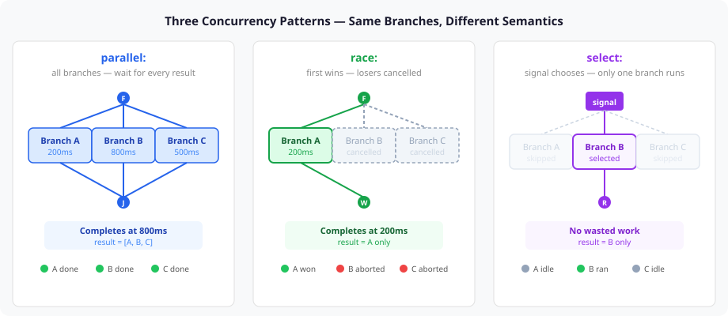
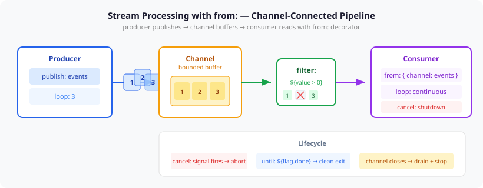
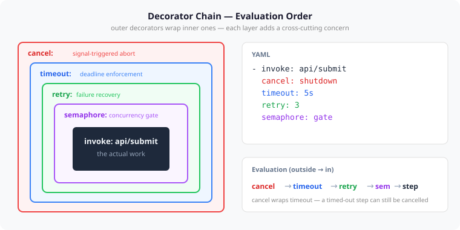

# Completing the Orchestration Language

Two days ago I wrote about porting the scheduling primitives — `at:`, `on-complete:`, `resource:/priority:` — from Java to TypeScript. That entry ended with "issues #537 and #538 cover the remaining parity work." Those issues are done now, along with five more. The playbook language went from "has concurrency" to "has an orchestration model."

What follows isn't a changelog. It's a walkthrough of why each primitive exists, what it replaced, and what patterns become expressible when they compose.

## Why a YAML orchestration language

Every workflow engine solves the same problem: how do you express coordination between steps without tangling it into the steps themselves? Temporal does it with Go/Java SDKs. Airflow uses Python DAGs. Step Functions use JSON state machines. Each encodes coordination as code in a general-purpose language, which means the coordination logic is as complex as whatever that language allows.

CaseHub chose YAML. Not because YAML is a good programming language — it isn't — but because a declarative grammar constrains what you can express. A step either has `retry: 3` or it doesn't. There's no `if (shouldRetry && retryCount < maxRetries && !isCritical)`. The grammar makes coordination visible: you read the YAML and see the orchestration topology, not an imperative program that produces one.

But a declarative approach only works if the grammar is complete enough. If authors routinely need to escape to JavaScript for patterns the grammar can't express, the declaration becomes a leaky abstraction. So the language needed to grow — not by adding general-purpose features, but by identifying the specific patterns that YAML authors were working around and giving each one a first-class keyword.

## What landed

Seven issues closed in one sprint. Here's what each one adds and why it matters.

### race: — first-to-complete with structured cancellation

```yaml
- race:
  - invoke: api/primary
    timeout: 2s
  - invoke: api/fallback
    timeout: 5s
```

`parallel:` waits for all branches. `race:` waits for the first. When a branch finishes, the runtime cancels every other branch through its `AbortSignal`. This isn't just Promise.race — it's structured cancellation. If branch A is inside a `retry: 3` loop when branch B wins, the retry loop receives the abort signal and stops. No leaked work, no orphaned HTTP requests.



The distinction from `select:` matters. `select:` is signal-based routing — a signal arrives and chooses which branch to execute. Only one branch ever starts. `race:` starts all branches and lets execution determine the winner. They look similar in a diagram but have completely different resource profiles: `race:` does redundant work intentionally, `select:` avoids it.

### from: — stream processing

```yaml
- step: consumer
  log: { message: "Processing ${from.value}" }
  from: { channel: events, filter: "${value > 0}" }
  loop: continuous
  cancel: shutdown
```

`from:` turns a step into a channel consumer. Each loop iteration reads one item from the channel, the filter runs before the step body, and `${from.*}` gives the step access to the consumed data. Combined with `loop: continuous`, this is a reactive pipeline stage that processes items until cancelled or until the channel closes.



The `until:` variant adds an exit condition evaluated before each receive. `from: { channel: events, until: "${flag.done}" }` reads items until a coordination flag is set. Three exit paths: explicit cancel signal, until-expression becoming true, or the channel closing after the producer finishes. Each path is visible in the YAML — no hidden state transitions.

Fan-in is built in. `from: { channels: [orders, returns] }` merges from multiple channels. Named consumers (`consumer: "worker-1"`) give each consumer its own cursor for competing-consumer patterns.

### loop: continuous, cancel:, background:

```yaml
- invoke: health/check
  loop: continuous
  cancel: shutdown
  background: true
```

`loop: continuous` runs until interrupted — no iteration count, no exit condition in the loop itself. `cancel:` provides the interruption mechanism: when the named signal fires, the step's AbortSignal is triggered and the decorator chain unwinds. `background:` spawns the step and continues the parent sequence without waiting, with scope-bounded lifetime — when the parent scope exits, background tasks are cancelled.

These three compose naturally because they're all decorators in the same chain. A background health check that loops continuously and cancels on shutdown is three decorators on one step, not a custom component.

### forEach: { collect: all } and parallel extensions

```yaml
- forEach item in items:
    - validate: { data: "${item}" }
    - store: { record: "${item}" }
  collect: all
```

`collect: all` accumulates results from every iteration into a list, available to subsequent steps. Without it, forEach is fire-and-forget — each iteration runs but results evaporate. This is the map in map/reduce.

`parallel:` gained a `discriminator:` option that completes when N of M branches finish (not all), and `cancelRemaining:` that aborts surviving branches after the discriminator threshold is met. Together with `race:`, this gives the language three completion strategies: all (parallel), first (race), and N-of-M (discriminator).

## The decorator chain as architecture

Every decorator in the playbook language occupies a fixed position in an evaluation chain. The ordering isn't arbitrary — it determines how decorators compose.



`cancel:` sits outermost. A cancelled step should stop immediately regardless of whether it's mid-retry or waiting for a semaphore permit. `timeout:` sits inside cancel — a timed-out step can still be externally cancelled, but cancellation doesn't reset the timeout. `retry:` sits inside timeout — retries happen within the timeout boundary, so three retries of a 1s step under `timeout: 5s` get 5 seconds total, not 5 seconds per attempt. `semaphore:` sits innermost — you acquire the permit after passing all guards, not before.

The new `cancel:` decorator makes this chain practical for long-running work. Before, the only way to stop a step was `timeout:` — a deadline. Now you can stop a step in response to an event. A retry loop that should abort when the user navigates away, a semaphore-gated batch that should drain when the system enters maintenance mode, a background task that should stop when its parent scope exits — all of these are `cancel:` with a named signal, not custom JavaScript.

AbortSignal propagation (#546) ties this together. Every decorator passes its signal to the next layer. When `cancel:` fires, the signal propagates through timeout, through retry, through the semaphore wait, into the step body. If the step body is an `invoke:` binding, the signal cancels the underlying HTTP request. This isn't bolted on — AbortSignal was added to the `Context` object and threaded through every decorator, so cancellation works uniformly whether the step is a REST call, a script, or a nested block.

## Structural forms — reading the intent

Issue #571 landed a few days later and completed the ergonomic story. Before, applying a decorator to a group of steps required a `block:` wrapper:

```yaml
# before: decorator on a block
- block:
    - validate: { data: "${item}" }
    - store: { record: "${item}" }
  retry: 3
```

After, decorators can be structural keys — the decorator keyword becomes the YAML key, and the steps are its value:

```yaml
# after: structural form
- retry 3:
    - validate: { data: "${item}" }
    - store: { record: "${item}" }
```

This works for `forEach`, `retry`, `timeout`, `when`, `mutex`, and `loop`. The Walker parses both forms — structural keywords are detected by regex matching against decorator names, and the steps array becomes an implicit block. The two forms are semantically identical; the structural form just eliminates the `block:` noise.

The combined-key form takes this further. `forEach item in items:` puts the iteration expression in the key itself. The YAML reads like pseudocode: "for each item in items, do these steps." This is the point where the grammar stops feeling like configuration and starts reading like intent.

## What this means practically

A rate-limited pipeline with a deadline, composed entirely from primitives:

```yaml
- deadline-create: { name: pipeline, deadlineMs: 3000 }
- parallel:
  - step: producer
    publish: { channel: jobs }
    loop: 3
  - step: consumer
    invoke: api/process
    from: { channel: jobs }
    semaphore: gate
    loop: continuous
    cancel: shutdown
```

Producer publishes to a channel. Consumer reads with `from:`, limited by a semaphore gate, looping continuously until cancelled. The outer `parallel:` runs both concurrently. A deadline scopes the entire pipeline. This is six lines of YAML doing what would be fifty lines of imperative code with manual promise management, AbortController plumbing, and semaphore bookkeeping.

That's the point of a complete orchestration grammar. Not that it can express everything — it deliberately can't. But the patterns that workflow authors actually need — retry, timeout, cancellation, streaming, racing, fan-out, fan-in, rate limiting, resource contention — are all first-class keywords that compose through a fixed decorator chain. The YAML declares the orchestration topology. The runtime handles the mechanics.
