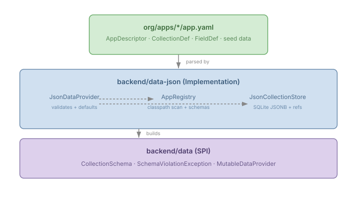
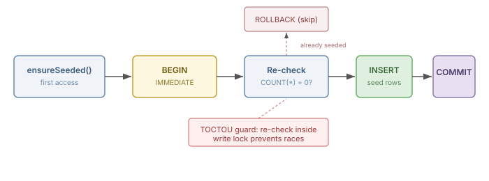

# App Descriptors and the Case for Declarative Data Contracts

Most application platforms treat data as an afterthought. You write your models in code, wire up your ORM, scatter validation logic across service layers, and hope someone remembered to add referential integrity checks before a user deletes an entity that something else depends on. The schema lives in the code. The seed data lives in a migration script. The validation lives wherever the last developer put it. Nothing declares intent; everything encodes implementation.

CaseHub Pages now has a different answer: `app.yaml`.

## What app.yaml declares

An application descriptor is a YAML file that lives on the classpath at `org/apps/{appId}/app.yaml`. It declares collections, their field schemas, seed data, and cross-collection references — all in one place:

```yaml
collections:
  tickets:
    fields:
      - name: title
        type: string
      - name: priority
        type: enum
        values: [low, medium, high, critical]
      - name: assignee
        type: ref
        ref: agents
    data:
      - data/tickets.json
  agents:
    fields:
      - name: name
        type: string
      - name: active
        type: boolean
        default: true
```

That's the entire data contract for a helpdesk app. Eight field types — `string`, `number`, `boolean`, `date`, `enum`, `array`, `object`, `ref` — cover what JSON collections actually need. No code generation. No annotation processing. No build-time step that breaks when someone upgrades a plugin. The YAML is the schema, and the runtime reads it directly.

## Why this matters

The practical value isn't the YAML itself — it's what the YAML makes possible across four concerns that are normally scattered:

**Schema validation on writes.** When a document is created or updated through `JsonDataProvider`, the runtime checks it against the declared `CollectionSchema`. An enum field that receives a value not in its allowed set throws a `SchemaViolationException` before touching the database. This happens at the SPI boundary — not in a controller, not in a service class, not wherever someone remembered to add it.

**Defaults that don't drift.** A field like `active: boolean, default: true` applies the default at write time via `CollectionSchema.applyDefaults()`. New fields with defaults work immediately for new documents without a migration. The default is declared next to the field, not buried in a constructor or a Flyway script.

**Seed data without ceremony.** Each collection can declare JSON files containing initial data. Loading is lazy (first access), idempotent (skips if the collection already has documents), and serialised by SQLite's `BEGIN IMMEDIATE` to prevent TOCTOU races. A fresh tenant gets working data without an init script, an admin panel, or a manual import.

**Referential integrity at the schema level.** A `ref` field declares a cross-collection relationship: `assignee: ref → agents`. The runtime queries `json_extract` to check whether any document references a target before allowing deletion. Restrict-on-delete, enforced automatically by what the YAML declares, not by what the developer remembered to check.

## The architecture in layers



Three layers, each with a clean boundary:

`CollectionSchema` lives in `backend/data` — the SPI module. It validates field types and applies defaults, but knows nothing about YAML, JSON storage, or SQLite. Any future `DataProvider` implementation can use the same schemas. This was a deliberate placement: validation belongs at the contract boundary, not in the storage implementation.

`AppRegistry` lives in `backend/data-json`. At startup it scans the classpath for `app.yaml` files, parses them through `AppDescriptorParser`, and builds `CollectionSchema` instances for each declared collection. It also owns seed data loading and reference tracking. The registry is the bridge between the declarative YAML world and the runtime storage.

`JsonDataProvider` delegates to `AppRegistry` for schema lookup on every write. If a collection has a registered schema, validation and defaults apply. If not — for ad-hoc collections created through the REST API without a descriptor — writes pass through unvalidated. This is intentional: the descriptor is opt-in, not a gate.

## The seed data race condition

Seed data loading has a subtle concurrency problem. Two requests hit an empty collection simultaneously. Both check "is the collection empty?" — both see zero documents — both load the seed data. You get duplicates.



The fix is a single-connection transaction using `BEGIN IMMEDIATE`, which acquires SQLite's write lock immediately rather than deferring it. Inside that lock, the count is re-checked — the classic TOCTOU guard. If another connection already loaded the data between the first check and the lock acquisition, the transaction rolls back cleanly.

This matters because each `JsonCollectionStore` method opens its own connection from the pool. The seed loader can't wrap store calls in a transaction — it bypasses the store entirely and executes SQL on a single connection. The trade-off is some code duplication against correct transactional behaviour. I'll take correct.

## ref fields and restrict-on-delete

Reference fields are the most consequential part of the descriptor. A field declared as `type: ref, ref: agents` means "this field holds an ID from the agents collection." The runtime uses that declaration in two ways.

First, `AppRegistry.getReferencingCollections("agents")` returns a map of every collection and field that points at agents. This is computed from the schema at startup — no annotation scanning, no reflection, no runtime discovery.

Second, `JsonDataProvider.hasReferences()` iterates those referencing collections and queries `json_extract(data, '$.assignee') = ?` to check for live references. The query runs against JSONB storage, using SQLite's built-in JSON functions. If any document in any collection references the target, deletion is blocked.

`CollectionResource.delete()` already called `hasReferences()` before this work — it was a no-op stub returning `false`. The descriptor infrastructure wired it into something real.

## What this opens up

The descriptor is a foundation, not a feature. Once the runtime knows the schema of every collection, several things become possible that weren't before.

Schema-aware query validation — rejecting queries that reference fields not in the schema, or applying type-appropriate comparisons (numeric vs lexicographic sort) based on declared field types.

Cascading operations — updating or nullifying reference fields when a target document is deleted, instead of only blocking the delete.

Schema evolution tracking — detecting when a deployed `app.yaml` narrows a field type or removes a field that existing documents use. The `defaults` mechanism already handles the "add new field" case; narrowing detection needs a version store, which is a separate concern.

The point of a declarative data contract is that it makes the implicit explicit. Every collection's shape, constraints, relationships, and initial state are visible in one file that the runtime enforces. No more hoping someone remembered to add validation. No more discovering referential integrity violations in production. The YAML is the contract, and the contract is the code.
