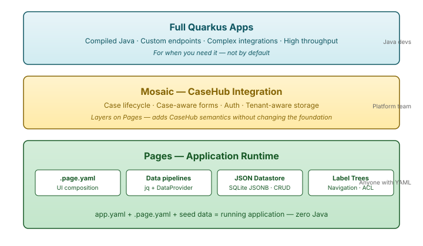
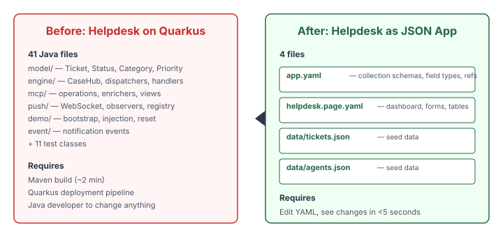
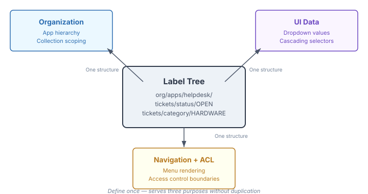

# Pages Becomes an Application Runtime

Every CaseHub application today requires a Quarkus project. Maven build, Java classes, deployment pipeline — even for an app that does nothing more than CRUD over a handful of JSON entities with some charts and a form. The helpdesk example in `casehub-examples` has 41 Java files. The domain model is four of them. The other 37 are infrastructure: REST endpoints, WebSocket plumbing, push observers, MCP tooling, demo bootstrapping.

I've been thinking about this for a while. The CaseHub APIs are largely the same across generic applications. What differs is the domain information — the shape of the data, the fields on the form, the columns in the table. For a class of simpler, less performance-sensitive apps, the entire compiled Java layer is overhead that buys nothing.

Pages already handles UI composition from YAML. Data pipelines bind to sources and transform with jq. Forms, charts, tables, selectors — all declarative. The only thing Pages couldn't do was persist data. Fix that, and Pages stops being a rendering engine and becomes an application runtime.

## What Already Existed

The surprise was how much of the foundation was already in place. Claude and I went through the codebase expecting to find a large gap between "renders pages" and "runs applications." The gap was narrower than either of us expected.

`MutableDataSource` — the TypeScript interface for CRUD — already existed in `pages-data`. Not as a stub. A full 188-line implementation called `mutableRestSource` with create, update, and delete dispatch. It was built for external API binding. Nobody had pointed it at a local datastore because no local datastore existed.

`DataProvider` — the backend SPI for pluggable data sources — already had implementations for SQL, Prometheus, and IoTDB. `DataResource` at `/api/dataset` already routed queries through `canHandle()`. Adding a JSON provider is the same pattern as `SqlDataProvider`.

`layout-sqlite` — the layout persistence module — already had SQLite in the dependency tree with HikariCP connection pooling and Flyway migrations. The database infrastructure was already built and tested. It just served one consumer.

The platform's `LabelPatternMatcher` already matched hierarchical paths with glob patterns. `LabelRule` already evaluated conditions against context maps and applied add/remove actions.

Taken individually, these are just components in a large codebase. Taken together, they're most of an application runtime waiting to be assembled.

## The Architecture



A JSON app is a directory of files. No build step. No deployment pipeline. No Java.

```yaml
# app.yaml
collections:
  tickets:
    fields:
      subject: string
      description: string
      category: { type: enum, values: [HARDWARE, SOFTWARE, ACCESS, OTHER] }
      priority: { type: enum, values: [LOW, MEDIUM, HIGH, URGENT] }
      status: { type: enum, values: [OPEN, TRIAGED, ASSIGNED, RESOLVED, CLOSED] }
      customerRef: string
      assigneeId: string
      resolution: string
```

That schema replaces four Java files — `Ticket.java`, `TicketStatus.java`, `TicketCategory.java`, `TicketPriority.java`. The `.page.yaml` files define dashboard metrics, table views, detail forms, creation forms, agent rosters — using exactly the same Pages components that already exist. The seed data is plain JSON.



The backend is a new `data-json` module implementing the existing `DataProvider` SPI, backed by SQLite with JSONB columns. One generic Quarkus service serves all JSON apps. Collections are keyed by `(tenant_id, app_id, collection, doc_id)`. Mutations go through a new `MutableDataProvider` SPI — an extension of `DataProvider` that adds create, update, and delete with explicit tenant context via `DataContext(tenantId)`.

We extracted the SQLite infrastructure from `layout-sqlite` into a shared `pages-sqlite` module. Both layout persistence and the new JSON datastore share one connection pool, one database file, with independent Flyway migration locations per consumer. That extraction is already committed and passing tests.

## Label Trees Do Triple Duty

The platform already had label trees — hierarchical path-based structures with pattern matching. I'd been thinking about them for app organisation, but Claude surfaced two more uses during our exploration.



**Organization.** `org/apps/helpdesk/collections/tickets` — the hierarchy structures apps, collections, and shared data. Org-level shared collections live under `org/shared/` and multiple apps reference them.

**UI data.** A label tree like `regions/europe/uk` directly populates a cascading dropdown. No separate JSON lookup file needed. The same structure that organises the data *is* the data for form fields.

**Navigation and ACL.** The tree drives the menu — render it, and users see their apps. Restrict label paths by role, and the menu becomes an access control boundary. `dashboards/finance/**` visible only to the finance team isn't a feature to build — it's a query against existing label infrastructure.

One structure, defined once, serving three purposes without duplication.

## Why This Changes the Barrier to Entry

The target user for JSON apps is someone who can write YAML and jq expressions but is not a Java developer. They want to define a data model, lay out a UI, and see it working — in seconds, not after a build cycle.

The current path to a CaseHub application: learn Java, learn Maven, learn Quarkus, scaffold a project, write model classes, write REST endpoints, write WebSocket observers, write push plumbing, configure deployment, deploy. If you want to change a field on a form, recompile and redeploy.

The JSON apps path: write `app.yaml`, write `.page.yaml`, drop in seed data. Edit the YAML, see the change. The iteration loop drops from minutes to seconds. The skill requirement drops from "Java developer" to "can write YAML."

This doesn't replace full Quarkus apps. Complex integrations, high-throughput systems, custom business logic that goes beyond jq expressions — those still need compiled Java. The point is that most apps don't start there, and many never get there. The helpdesk is a good example: ticket CRUD with status tracking, category filtering, priority sorting, a dashboard with metrics. None of that needs Java. All of it can be expressed declaratively.

## The Dashboard Problem Falls Out for Free

There was a separate long-standing gap: Pages are static files. No runtime creation, no dynamic organisation, no access control on views. Users coming from tools like Grafana expect to create dashboards at runtime, organise them into folders, control who sees what.

With the JSON app infrastructure, a page becomes a document in a collection. The `pages` collection stores `.page.yaml` content. Creating a dashboard is saving a document. Organising dashboards into folders is labeling with tree paths. Access control is restricting label path visibility by role. The entire dashboard lifecycle falls out of the same infrastructure that makes JSON apps work. It's not a separate feature — it's a use case of the same mechanism.

## Mosaic Layers On Top

Pages is CaseHub-agnostic. The JSON apps runtime stays in Pages. But Mosaic — the CaseHub integration layer — can layer case lifecycle on top of the same collections.

A "case app" is a JSON app where Mosaic registers case-aware forms in the same page slots, intercepts mutations to inject case lifecycle (create a document → open a case, label change → state transition), and enriches the navigation with case counts and SLA indicators. The Pages foundation exposes SPIs; Mosaic registers its implementations.

The helpdesk is the proof of concept for both layers. Phase 1 runs as a pure JSON app — ticket CRUD, manual status changes, charts and forms. Phase 2 adds the case engine — automatic triage, human task routing, notification on resolution. Same data, same UI components, different lifecycle semantics layered on by Mosaic.

## What's Next

The `pages-sqlite` shared module is landed. The epic is filed with nine child issues tracking the critical path: `MutableDataProvider` SPI, `data-json` module, app descriptor parser, frontend wiring, apps management view, helpdesk port, label tree enumeration, and dynamic page management.

The critical path to a running helpdesk demo is about a week of backend work. The frontend pieces — `mutableRestSource`, data tables, charts, forms, schema-form — already exist. The backend needs the datastore, the mutation endpoints, and the app descriptor parser. Once those land, the helpdesk sketch we've already written becomes a working application.

I'm pausing the ops apps I was building on Quarkus. They're exactly the class of application that should be JSON apps instead. Building them on Quarkus now means rewriting them in a week when this lands. Better to invest the week in the foundation and build everything on it.
