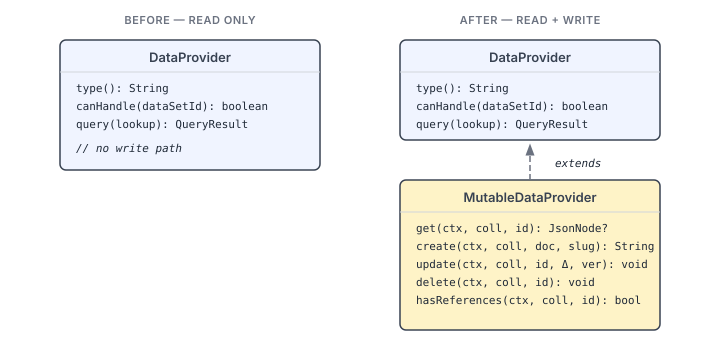
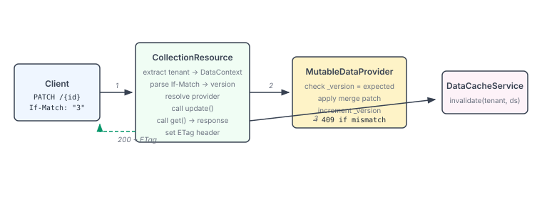

# When Read-Only Isn't Enough

Pages has had a `DataProvider` SPI for months. SQL, Prometheus, IoTDB — each registers via CDI, responds to `canHandle()`, and returns tabular data through `query()`. The read path works well. But every application we've built on top of it that needs to *write* data has required a full Quarkus backend deployment — compiled Java, a custom REST layer, a deployment pipeline. For a helpdesk app that's basically CRUD over JSON, that's an absurd amount of ceremony.

The JSON Apps epic is about fixing that. And the first piece is giving the data layer a write path.

## The shape of the problem

`DataProvider` does one thing: answer queries. Three methods — `type()`, `canHandle()`, `query()`. Clean, minimal, well-tested across three implementations. But it has no notion of creating, updating, or deleting a document. No concurrency model. No identity scheme. Adding write support to the *existing* interface would break every provider that only reads — which is all of them.

So the write path needs its own SPI that extends the read path without disturbing it.



`MutableDataProvider extends DataProvider`. Any provider that implements it gets both read and write capabilities. Providers that only read — SQL, Prometheus, IoTDB — don't see the new methods. CDI discovery handles the routing: `DataResource` injects `Instance<DataProvider>` for queries, `CollectionResource` injects `Instance<MutableDataProvider>` for mutations. Same SPI pattern, no coupling between them.

## Why slugs, not UUIDs

The `create()` method returns a document ID — and that ID is a CMS-style slug, not a UUID. This was a deliberate choice that goes against the path of least resistance.

UUIDs are easy. Generate one, done. But the documents these providers will store are real-world things — helpdesk tickets, customer records, knowledge articles. A URL like `/api/collections/helpdesk/tickets/urgent-network-outage` tells you what you're looking at. `/api/collections/helpdesk/tickets/a3f7b2c1-9e4d-4f2a-8b7c-...` does not.

The implementation supports both paths: a client can provide an `_id` field explicitly, or the server derives one by slugifying a source field (defaulting to `title`). Collisions get numeric suffixes — `urgent-network-outage-1`, `urgent-network-outage-2` — following the same pattern WordPress, Ghost, and Strapi have used for years. Slugs are immutable after creation: renaming a ticket's title doesn't change its URL. References never break.

```java
public static String slugify(String input) {
    if (input == null || input.isBlank()) return "";
    String slug = NON_ALNUM.matcher(input.toLowerCase()).replaceAll("-");
    slug = LEADING_TRAILING_HYPHENS.matcher(slug).replaceAll("");
    if (slug.length() > MAX_SLUG_LENGTH) {
        slug = slug.substring(0, MAX_SLUG_LENGTH);
        slug = LEADING_TRAILING_HYPHENS.matcher(slug).replaceAll("");
    }
    return slug;
}
```

Nothing exotic. Lowercase, strip non-alphanumeric, collapse hyphens, cap the length. The interesting part is `resolveSlug()`, which checks for an explicit `_id` first, then falls back to slugifying the configured field.

## Optimistic concurrency at the SPI level

The `update()` method takes an `OptionalInt expectedVersion`. This is the SPI encoding of `If-Match` — if present, the implementation must check the stored `_version` and throw `VERSION_CONFLICT` if they don't match. If absent, last-write-wins.

I put this in the SPI contract rather than leaving it to individual implementations because concurrency semantics shouldn't vary between providers. A consumer calling `update()` shouldn't need to know whether the backing store is SQLite, Postgres, or an in-memory map — the version check behaviour should be the same everywhere. The SPI makes it contractual.



The `CollectionResource` parses `If-Match: "3"` into `OptionalInt.of(3)` and passes it through. The provider does the atomic check. On mismatch, a `MutationException("VERSION_CONFLICT", ...)` propagates up through the `MutationExceptionMapper` to a 409 response. The client sees a standard HTTP conflict and can retry with a fresh version.

## The error taxonomy

Five error codes, one exception class:

| Code | HTTP | When |
|------|------|------|
| `VALIDATION_ERROR` | 422 | Malformed document |
| `VERSION_CONFLICT` | 409 | If-Match mismatch |
| `NOT_FOUND` | 404 | Document doesn't exist |
| `SLUG_CONFLICT` | 409 | Slug collision exhausted |
| `REF_DELETE_BLOCKED` | 409 | Referencing documents exist |

The existing `DataQueryException` handles read errors. `MutationException` handles write errors. Same pattern — a `code` field and a JAX-RS mapper — just scoped to mutations. We could have added new codes to `DataQueryException`, but conflating "your query was malformed" with "your update had a stale version" would have muddied the semantics.

## What this unlocks

With `MutableDataProvider` in place, the next piece — `data-json`, backed by SQLite JSONB — can implement the interface and immediately get a REST API for free. No resource class to write. No error handling to think about. Define a collection in `app.yaml`, point it at a schema, and the platform handles CRUD, caching, concurrency, and referential integrity.

That's the point of an SPI that includes the write path: the application developer's surface area shrinks from "build a Quarkus REST layer" to "declare a collection." The 41-file helpdesk backend becomes 4 YAML files.

The SPI is the contract. Everything downstream — the REST surface, the error model, the concurrency guarantees — flows from getting that contract right.
