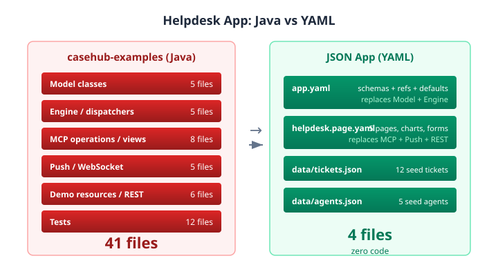
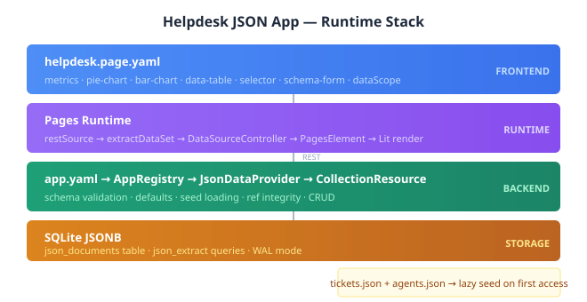

# 41 Java Files, 4 YAML Files, and the Bugs That Proved It Works

The casehub-examples repository has a helpdesk app. Tickets, agents, categories, priorities, a status lifecycle, a dashboard with metrics and charts, a filterable queue, an edit form with auto-save, a create form with validation. Forty-one Java files across model classes, engine dispatchers, MCP operations, push WebSocket handlers, REST resources, and tests.

I rebuilt it in four files. No Java. No TypeScript. No code at all.

## What the four files do

`app.yaml` declares two collections — tickets with eight fields (including enums for category, priority, and status, plus a ref to agents) and agents with four fields. It points at seed data files. The `AppRegistry` discovers it on the classpath, parses it, builds `CollectionSchema` instances, and from that moment the runtime enforces types, applies defaults, validates enums, checks referential integrity, and seeds data on first access. The entire data layer — schema, validation, relationships, initial state — is 40 lines of YAML.

`helpdesk.page.yaml` defines five pages behind a tab bar. The Dashboard page has four metric cards (open tickets, urgent, unassigned, resolved today), three charts (category pie, priority bar, status donut), and a filtered recent-tickets table. The Ticket Queue page has a status dropdown filter, category label filters, and a sortable table showing all fields. Ticket Detail is a `dataScope` form with auto-save via REST — edit any field and the PATCH fires after two seconds. New Ticket is a `schema-form` with `forceCreate: true` that generates inputs from the JSON schema and POSTs on submit. The Agents page shows a table and a speciality breakdown chart. All of this — layout, data binding, filtering, grouping, CRUD — is declarative YAML.

`data/tickets.json` and `data/agents.json` are the seed data. Twelve tickets across all categories, priorities, and statuses, with realistic subjects and descriptions. Five agents with different specialities. The runtime loads them lazily and idempotently — first request seeds, subsequent requests skip.

## The stack that makes it possible

The page YAML references datasets by URL. The Pages runtime fetches from those URLs, extracts tabular data, and feeds it to Lit web components — `data-table`, `metric`, `pie-chart`, `bar-chart`, `selector`, `schema-form`. Each component renders from the dataset it receives. Lookups with filters and group-by operations happen client-side. Mutations (create, update, delete) go through the `mutableRestSource` to REST endpoints backed by `JsonDataProvider` and SQLite JSONB storage.

No glue code. No wiring layer. No adapters or mappers. The YAML declares what data exists and how to display it. The runtime connects the two.

## Three bugs that matter more than the app

The helpdesk app was the first real end-to-end test of the JSON app runtime. Unit tests and isolated component tests had all passed. The integration was where things broke.

**Bug 1: schema-form rendered enum selects as zero-height readonly spans.** The `PagesSchemaForm` component computed `isDisplay = !this._editable`, and `_editable` was only set to `true` when the page had a `dataScope` with a `save` config. Without a `dataScope` — the normal case for a standalone create form with `forceCreate: true` — every field rendered in display mode. Enum selects became 10-pixel-tall readonly `` elements instead of full-height `<select>` dropdowns. The fix was one line: `isCreateMode` overrides the display state.

**Bug 2: typed text vanished on blur.** The `renderContent` method rebuilt `source.data` from the (empty) dataset on every re-render cycle. User-typed values were captured in `_dataMirror` via the `onChange` callback, but the property palette received fresh empty data on each render and reset field values. In create mode, the form needs to feed `_dataMirror` — the user's working state — back to the palette, not the empty source data.

**Bug 3: submit did nothing.** The Submit button called `submit()`, which validated the form and dispatched a `pages-record-create` custom event. Nobody caught the event. The `submitUrl` and `submitMethod` props were in the YAML but stripped by the Zod validation schema because they weren't declared in `SchemaFormProps`. Two type declarations — the TypeScript interface and the generated Zod schema — needed the new fields. Then `submit()` needed to actually `fetch()` the URL.

Each of these passed in isolation. The component rendered correctly when given a dataset. The form validated correctly when given data. The schema parsed correctly from YAML. It was the composition — a standalone create form, inside a tab, without a dataScope, submitting to a REST endpoint — that exposed the gaps. That's why the helpdesk app matters more as a test than as a demo.

## What this changes about building applications

The 41 Java files in casehub-examples are good code. Well-structured. Tested. But they encode things that should be declared. The `TicketCategory` enum is a Java class with four values — that's a schema declaration wearing implementation clothes. The `HelpDeskCaseHub` engine is a state machine expressed as method dispatch — the status lifecycle belongs in a rule or a flow definition, not in imperative code. The `HelpdeskPushEndpoint` is real-time event plumbing — infrastructure the platform should provide, not something each app rebuilds.

The JSON app version makes these separations explicit. The schema is in `app.yaml`. The UI is in `helpdesk.page.yaml`. The data is in JSON files. Each concern lives in exactly one place, expressed in the most natural format for that concern. A new developer reads four files and understands the entire application. Not the framework. Not the platform. The application.

The gap that remains is the case-side logic — triage rules, assignment policies, escalation timers, resolution workflows. The current helpdesk app does CRUD. The Java version had dispatchers and handlers for those flows. Replacing those with declarative constructs — playbooks, scenarios, rules — is the next layer. The YAML app proves the data and UI layers are ready. The case engine is the next frontier.

The ratio tells the story. Forty-one files of code to express what four files of YAML express equally well. The code wasn't wrong. It was just answering the wrong question. The question isn't "how do I build a helpdesk app?" The question is "what IS a helpdesk app?" — and the answer fits in four files.
