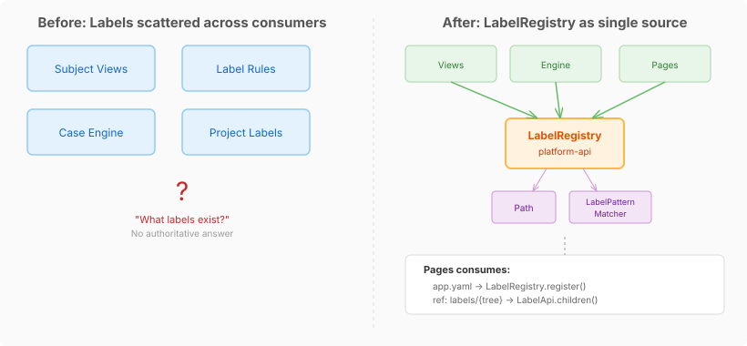
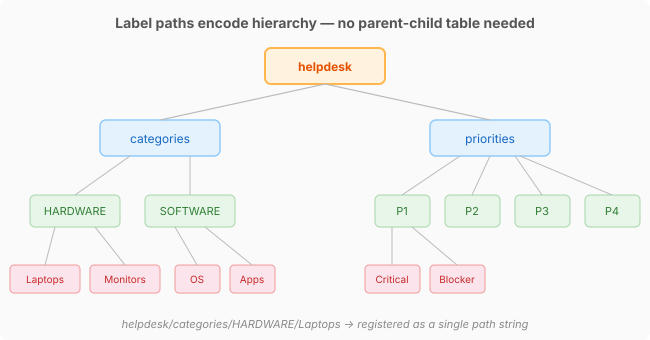

# Labels as Infrastructure: Why Hierarchical Label Trees Belong in the Platform

Every application needs categories. Helpdesk tickets have `HARDWARE/Laptops` and `SOFTWARE/OS`. Insurance claims have `Motor/Theft` and `Property/Flood`. Medical records have `Cardiology/Arrhythmia` and `Neurology/Stroke`. These aren't flat enums — they're trees. And every application that needs them ends up building its own store, its own enumeration endpoint, its own dropdown-fetching logic.

I started issue #600 thinking the solution was local. Pages needed label trees for navigation menus and cascading dropdowns in JSON apps. The obvious move was a `LabelTreeStore` backed by SQLite — the same pattern as every other Pages data structure. Quick, self-contained, done.

The platform already disagreed.

## The gap I almost missed

The CaseHub platform has had label infrastructure for a while. `Path` gives you a proper hierarchical type with `parent()`, `isAncestorOf()`, and `depth()`. `LabelPatternMatcher` does glob matching — `legal/*` for direct children, `legal/**` for all descendants. `LabelRule` and `LabelAction` provide a rules engine for adding and removing labels from entities. `SubjectViewSpec` filters views by label patterns.

All of that is consumption infrastructure. Nothing answered the definition question: *what labels actually exist in this tree?*

Without a registry, the only way to enumerate labels was to scan every entity that carries them. That's O(entities), it can't report empty branches, and it's not authoritative. If I create a category `HR/Recruitment` before any tickets are filed against it, no entity scan will find it.



Platform issue #694 filled this gap with `LabelRegistry` — a tenant-scoped registry following the same pattern as `EndpointRegistry` and `DataSourceRegistry`. Register a label path, enumerate children at a prefix, resolve a single node. The SPI, an in-memory implementation, and a `@McpDomain("labels")` endpoint providing REST, GraphQL, and MCP access — all landed before I wrote a line of Pages code.

## Paths encode hierarchy without a parent-child table

The design choice that makes this work cleanly: labels are path strings. `helpdesk/categories/HARDWARE/Laptops` is a single string, not a row in a parent-child join table. The `Path` type splits it into segments. `LabelPatternMatcher` does prefix matching. The registry auto-creates ancestor nodes when you register a leaf — registering `HARDWARE/Laptops` implicitly creates `HARDWARE`.



This is the same insight behind filesystem paths, URL routing, and Prometheus label matchers. Trees encoded as delimited strings are queryable with prefix matching, don't need recursive CTEs, and serialise trivially. The trade-off is that reparenting is expensive — moving `HARDWARE` under `IT` means rewriting every descendant path. For label taxonomies, that trade-off is almost always right. Categories change slowly; enumeration happens constantly.

## Tenant scoping without app scoping

Labels in the platform are scoped by tenant, not by application. An app that ships with label declarations registers them under `PLATFORM_TENANT_ID` — a sentinel that makes them visible to every tenant. A tenant that needs `IT/Hardware/Docking Stations` beyond what the app defined registers that under their own tenant ID. Resolution merges both, with tenant labels winning on conflict.

This means `LabelRegistry` has no `appId` parameter. The application's identity becomes part of the path prefix instead: `helpdesk/categories/HARDWARE/Laptops`. Pages scopes to the app's subtree when it fetches labels for a dropdown — that's consumer-side logic, not registry-level.

I initially proposed making labels app-scoped in the SPI. The correction was right: app-scoping would have coupled the registry to a concept (`appId`) that doesn't exist in the engine, the work system, or the view layer. All of those use labels. None of them know what an "app" is.

## What Pages actually does

With the platform handling storage and enumeration, Pages #600 turned out to be three things:

**Parse label declarations from `app.yaml`.** A new top-level `labels` key, sibling to `collections`:

```yaml
labels:
  categories:
    - HARDWARE/Laptops
    - HARDWARE/Monitors
    - SOFTWARE/OS
    - SOFTWARE/Applications
  priorities:
    - P1/Critical
    - P1/Blocker
    - P2/High
```

`AppDescriptorParser` parses these into `LabelTreeDef` records. `AppRegistry` calls `LabelRegistry.register()` at startup for each leaf path, prefixed with the app ID and tree name.

**Wire dropdowns via `ref: labels/{tree}`.** A field with `ref: labels/categories` in `app.yaml` works like a collection ref (`ref: agents`) but resolves against the label tree instead. On the frontend, the field is mapped to `ColumnType.LABEL` and populates its dropdown from the platform's label endpoint rather than from distinct data values.

**Bind navigation to label trees.** A navTree group with `labelSource: categories` populates its items dynamically from the label tree instead of static YAML children. Selecting a label item emits a filter event that narrows the data view.

Fifteen files changed, six commits. No new storage, no new REST endpoint, no new module. Pages just plugs into the platform SPI.

## The argument for platform-level vocabulary

The temptation with any integration-tier project is to build locally. Pages has SQLite. Pages has REST endpoints. Pages could have stored label trees itself. It would have worked.

But it would have been the fourth label store. The engine carries `List<String> labels` on case definitions. The connectors store project labels via `ProjectPlatform.Labels`. The view system matches entities by label patterns. None of them agree on where label definitions live, because until `LabelRegistry`, label definitions didn't have a home.

The value of pushing vocabulary down to the platform isn't abstraction for its own sake. It's that every consumer gets the same answer to "what labels exist." When Pages registers `HARDWARE/Laptops` at app startup, the engine can see it. When a tenant adds `HARDWARE/Docking Stations`, the dropdown in Pages and the view filter in the dashboard see it simultaneously. No sync, no event bus, no eventual consistency — one registry, one truth.

That's the kind of infrastructure decision that doesn't look like much in a diff. Six commits, a handful of new records, a few interface extensions. But the alternative — a fifth label store with its own sync problem — would have been technical debt from the moment it shipped.
