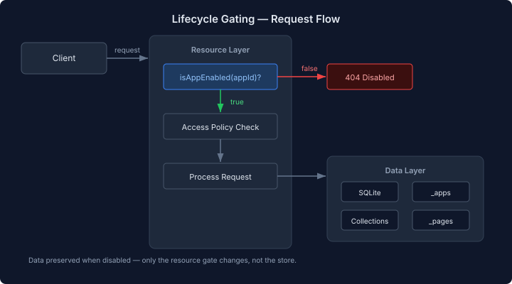

# App Lifecycle as Data, Not Configuration

A composable app platform needs lifecycle controls. Users install apps, apps misbehave, users need to stop them without losing data. The question is where those controls live.

## Why not PreferenceStore?

The platform has a `PreferenceStore` SPI with per-tenant key-value storage and schema validation. It's the canonical place for user-facing settings. Pages already depends on platform-api — `TenancyConstants`, `LabelRegistry`, identity SPIs — so adding another module isn't the concern.

The concern is data locality. An app's lifecycle state is a property of the app, not a user preference. `enabled` answers "is this app running?" — it belongs with the app descriptor, not in a separate preference namespace that has to be joined at query time. Splitting app state across two stores means two REST calls to answer one question, two places to look when debugging, and a schema-form that needs to merge data from two sources to render one settings panel.

## Settings belong with metadata

The `_apps` collection already holds app metadata — name, description, icon, route. Adding `enabled`, `displayName`, `autoSeed`, and `maxDocuments` as fields on the same document means settings live next to the data they describe. One REST call returns everything. The schema-form component renders settings directly from the document schema — no adapter, no merge.

```java
static final CollectionSchema APPS_SCHEMA = new CollectionSchema("_apps",
    Map.ofEntries(
        Map.entry("appId", "string"),
        Map.entry("name", "string"),
        // ... existing fields ...
        Map.entry("enabled", "boolean"),
        Map.entry("displayName", "string"),
        Map.entry("autoSeed", "boolean"),
        Map.entry("maxDocuments", "number")
    ),
    Map.of("enabled", (Object) true,
           "autoSeed", (Object) true,
           "maxDocuments", (Object) (-1)),
    Map.of()
);
```

Four fields. Defaults baked into the schema. An app with no settings document is enabled by default — static classpath apps don't even need an explicit entry.

## Gating at the resource layer

Stopping an app means its collections return 404 and its pages become inaccessible. The data stays in SQLite. Starting it brings everything back.

The implementation choice was where to check the flag. Two candidates: the `JsonCollectionStore` (data layer) or the JAX-RS resources (API layer). I went with the resources.



The store stays unaware of lifecycle state. It doesn't know or care whether an app is enabled — it stores and retrieves documents. The gate is a five-line method at the top of `PageResource` and `AppCatalogueResource`:

```java
private Response checkAppEnabled(String appId) {
    if (!appRegistry.isAppEnabled(appId)) {
        return Response.status(404)
            .entity(Map.of("error", "App is disabled: " + appId)).build();
    }
    return null;
}
```

This matters because the store is shared infrastructure. It backs collections, pages, app catalogues, seed data — everything. Injecting lifecycle awareness into the store means every caller inherits that complexity. Gating at the resource layer means the store is testable in isolation, and the lifecycle check is visible where the HTTP response is shaped.

`CollectionResource` is in a different module (`backend/data`) and doesn't have access to `AppRegistry`. That's a natural boundary — if someone hits `/api/collections/disabled-app/contacts` directly, it still works. The gating covers the paths users actually take: pages and app catalogues. Direct collection access is a developer escape hatch, not a user-facing concern.

## Cache eviction on stop

Stopping an app sets `enabled=false` on the `_apps` document and evicts the backend data cache. Without eviction, a stopped app's pages could still be served from `DynamicPageLoader`'s LRU cache — the page renders fine but every data call returns 404. That's worse than a clean 404; it looks broken rather than disabled.

The eviction is coarse-grained — `DataCacheService.invalidate()` for the app's namespace. Per-page cache eviction would be more surgical, but the common case is stopping the whole app, not individual pages. Coarse is correct here.

## What this means for Pages

Pages can now ship a management view as a page YAML that works everywhere the runtime works. A table of installed apps, a schema-form for settings, action buttons for start/stop — all rendered from the same runtime that renders every other page. The management UI is just another page, not a special-cased admin panel.

That's the real architectural win. When the management interface and the managed apps use the same rendering pipeline, the platform doesn't need a separate admin tier. The page is the admin.
