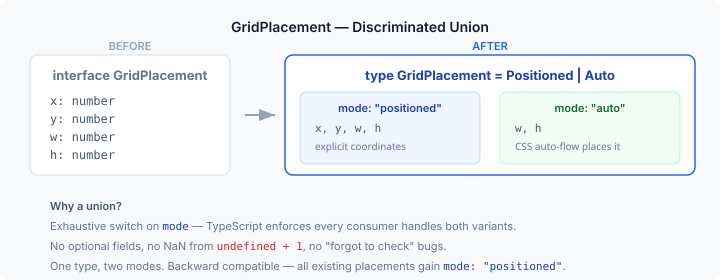
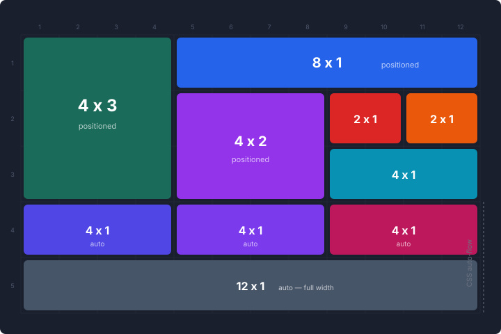

# One Type, Two Modes: How a Discriminated Union Unlocked Grid Spanning

Page layouts in CaseHub had two models for placing components on a grid, and neither was right.

The first model was coordinate-based. Every component declared `{x: 0, y: 0, w: 6, h: 2}` — column, row, width, height on a 12-column CSS grid. It supported spanning: a chart could occupy eight columns while a summary card took four. But it required authors to calculate every coordinate. Move one panel and you recalculate the rest. There was no auto-flow — no way to say "put these three cards in a row, figure out the positions."

The second model was slot-based. Layouts like `columns` and `rows` placed children sequentially. No coordinates, no math. But no spanning either. Every child occupied exactly one slot. A metric card couldn't stretch across two columns. A tall sidebar panel couldn't span three rows.

Two models, each missing what the other had.

## The union that bridges them

The fix is a discriminated union on `GridPlacement`:

```typescript
type GridPlacement =
  | { mode: 'positioned'; x: number; y: number; w: number; h: number }
  | { mode: 'auto'; w: number; h: number };
```



Positioned mode is the existing coordinate model, unchanged. Auto mode declares span size only — width and height — and lets CSS `grid-auto-flow: row` handle placement. The browser figures out where items go. Authors write `{ mode: auto, w: 4, h: 1 }` and three of those fill a 12-column row.

The two modes mix freely. Pin a hero chart at the top with explicit coordinates. Let metric cards auto-flow below it. The positioned items anchor the layout; the auto items fill the remaining space.

## What this looks like in practice



The top section uses positioned items with explicit coordinates. The 4×3 teal block spans four columns and three rows — a tall sidebar-style panel. The 8×1 blue bar spans the remaining width beside it. The 4×2 purple block fits below the blue bar, with smaller 2×1 blocks filling the gaps. Every item knows its exact grid position.

The bottom section uses auto-placed items. Three 4×1 blocks flow left-to-right, each occupying four of twelve columns. A 12×1 block takes the full width below them. No coordinates — just span sizes. The CSS grid places them in reading order.

This is the YAML that produces it:

```yaml
items:
  # Positioned: explicit coordinates
  - placement: { mode: positioned, x: 0, y: 0, w: 4, h: 3 }
    component: { type: sidebar-panel }
  - placement: { mode: positioned, x: 4, y: 0, w: 8, h: 1 }
    component: { type: bar-chart }

  # Auto: span size only, CSS places them
  - placement: { mode: auto, w: 4, h: 1 }
    component: { type: metric, properties: { title: Revenue } }
  - placement: { mode: auto, w: 4, h: 1 }
    component: { type: metric, properties: { title: Target } }
  - placement: { mode: auto, w: 4, h: 1 }
    component: { type: metric, properties: { title: Profit } }
```

This is a new `items:` format alongside the existing `components:` (flat list) and `rows:` (structured layout). All three produce `GridItem[]` internally. Existing YAML is unchanged — backward compatible.

## Why a union and not optional fields

The first design made `x` and `y` optional: `{ x?: number; y?: number; w: number; h: number }`. This is the intuitive approach. It's also wrong.

The renderer function `applyGridPlacement` computed `placement.x + 1` to convert from 0-based model coordinates to 1-based CSS grid lines. When `x` is `undefined`, that expression produces `NaN`. The CSS property silently accepts it. The panel renders at no position, visible in the DOM but invisible on screen. No error, no warning, just a missing component.

A discriminated union makes the two modes explicit at the type level. TypeScript's exhaustive checking forces every consumer to handle both:

```typescript
switch (placement.mode) {
  case 'positioned':
    el.style.gridColumn = `${placement.x + 1} / span ${placement.w}`;
    break;
  case 'auto':
    el.style.gridColumn = `span ${placement.w}`;
    break;
}
```

If you forget a case, the compiler tells you. If you access `placement.x` without narrowing, the compiler tells you. The bug class — "forgot to check if optional field exists" — is eliminated by the type system, not by discipline.

## The accessibility decision that shaped the design

CSS Grid has a `dense` packing mode. When items are placed explicitly, `grid-auto-flow: row dense` fills gaps by reordering auto-placed items. A three-column auto item might jump ahead of a six-column one to fill a gap left by an explicitly positioned item. Visually efficient. Practically hostile.

WCAG 2.1 Success Criterion 1.3.2 (Meaningful Sequence) requires that the visual order of content matches the DOM order. Screen readers follow DOM order. Keyboard navigation follows DOM order. When `dense` packing reorders items visually but not in the DOM, a sighted user and a screen reader user see different sequences. The screen reader announces content in an order that doesn't match what's on screen.

The design uses `grid-auto-flow: row` — no dense packing. Auto-placed items follow YAML array order, which determines DOM order, which determines visual position. Gaps may appear where explicitly positioned items block auto-flow. That's an acceptable cost. Predictable, accessible ordering isn't negotiable.

## DOM ordering for mixed grids

The renderer sorts children for WCAG compliance. Positioned items are rendered first, sorted by `(y ascending, x ascending)` — top-left to bottom-right, matching visual scan order. Auto items are rendered after, in their original array order. This ensures DOM order matches visual order for the common cases (all-positioned or all-auto grids). In mixed grids, positioned items anchor the DOM order while auto items fill remaining positions.

## Optional row height

Grid rows default to `min-content` — they size to their tallest child. This works for most layouts but creates unpredictable row heights when panels have varying content. The new optional `rowHeight` property on `GridProps` sets a fixed pixel height per row:

```yaml
type: grid
properties:
  columns: 12
  rowHeight: 80
```

When `rowHeight` is present, `grid-auto-rows` uses the pixel value. Panels that exceed the height get `overflow: hidden` — authors can override to `overflow: auto` via component styles. This becomes essential for the drag-and-drop layer coming next: DnD snap targets need predictable cell dimensions.

## What comes next

This is Layer 1 of a three-layer design. The model and rendering are done. Layers 2a and 2b add visual editing:

**Layer 2a (#614) — Drag to reposition, drag to resize.** An edit mode toggle reveals grid lines and drag handles. Pointer events with grid-cell snapping — not pixel-based. A push/displace collision algorithm (studying Gridstack.js and React-Grid-Layout as reference, custom-built to avoid DOM ownership conflicts with model-driven rendering) resolves overlaps by pushing displaced panels downward. Visual preview during drag shows where everything will land.

**Layer 2b (#615) — Insert and YAML round-trip.** Insertion zones between panels for dropping new components. All mutations flow through `PageDocument` — the CST-backed facade from the Visual YAML Builder (#434) — giving undo/redo for free. DnD changes mutate YAML placement properties in-place, preserving formatting and comments.

The DnD infrastructure is designed to be layout-agnostic. The `grid` adapter handles 2D spanning. Future adapters for `columns` (horizontal only), `rows` (vertical only), and `tabs` (reorder only) plug into the same pointer event machinery and PageDocument integration. Different placement models, shared interaction infrastructure.

For now: the grid can span. Components can occupy multiple columns, multiple rows, or both. Authors can mix explicit coordinates with auto-placed items in a single grid. The gallery has a "Grid Spanning" sample that makes it visually obvious — colored blocks labeled with their span dimensions, positioned items interlocking with auto-placed items flowing into remaining space.
