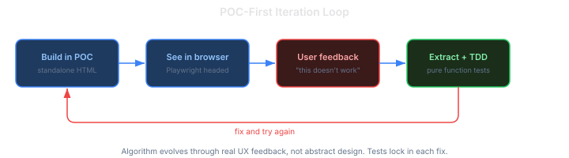
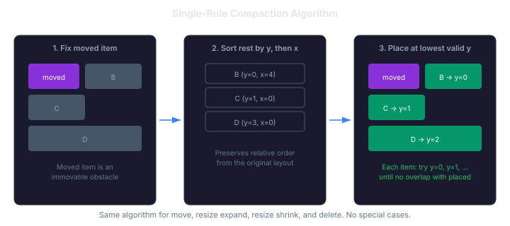
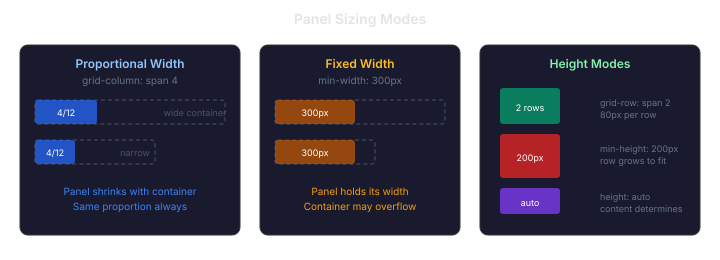

# Tetris, Not Pixels: Building a Grid Editor That Actually Works

*Follows [When Custom Stops Being an Advantage](/docs/blog/2026-11-06-mdp01-when-custom-stops-being-an-advantage.md). That entry ended: "I'll know the pivot is right when I can drag a panel and predict where it will land before I release the mouse."*

The previous session shipped the architecture: bridge pattern, YAML round-trip, format conversion. Then the interaction failed. This session rebuilt it from the ground up, starting with a question that changed the approach: "Why absolute positioning? We did this before with a table."

## The Table Model Was Already There

The grid layout in CaseHub Pages uses CSS Grid with integer coordinates: `{ x, y, w, h }` on a 12-column grid. The rendering is one function:

```typescript
element.style.gridColumn = `${x + 1} / span ${w}`;
element.style.gridRow    = `${y + 1} / span ${h}`;
```

Column start, row start, column span, row span. It's a table. The Grid Spanning showcase in the gallery demonstrates every combination — 4x3 blocks next to 2x1 blocks next to 8x1 bars — all rendered natively by the browser's CSS Grid engine.

The previous implementation's drag ghost was absolutely positioned: `position: absolute` with pixel `top`/`left`/`width`/`height` computed from grid geometry. It floated above the layout in an overlay. It couldn't show where the panel would actually land because it wasn't participating in the grid. The CSS Grid items were structural; the drag feedback was decorative.

The fix was to make the drag feedback structural too.

## Prototype First, Framework Never

The original plan had four batches of framework integration ending with visual verification in the last batch. That's backwards. Three problems with the plan would have produced code that passed tests and didn't work:

1. **CSS Grid transitions don't exist.** The plan described `transition: grid-column 200ms ease`. The `grid-column` property isn't animatable. That line would have done nothing. The smooth reflow would have been items teleporting between positions.

2. **No visual verification until the end.** Unit tests for integer arithmetic pass while the drag feels wrong.

3. **No prototype.** Debugging pointer interactions inside a framework with YAML rendering, bridges, and event contracts is brutal.

The rebuilt approach: a standalone HTML file. No framework, no YAML, no build step. A 12-column CSS Grid with coloured panels, pointer events, and the compaction algorithm in 30 lines of JavaScript. Every interaction is visible in the browser within seconds of writing it.



The loop ran fast. Build a feature in the POC, open it in Playwright, try it, get feedback, fix it, try again. Each iteration was minutes, not hours. The algorithm evolved through real UX feedback: "the displaced items jump to the bottom," "shrinking doesn't restore the layout," "the top border resize moves instead of resizing."

## The Compaction Algorithm: One Rule

The first implementation had two phases fighting each other: "insert rows" to make space, then "compact upward" to fill gaps. The insert phase was optimistic; the compact phase was greedy. They disagreed on where items belonged, producing visual artifacts.

The fix was to recognise that both phases were trying to solve the same problem. The unified algorithm is one rule:



Fix the moved item at its new position. Sort every other item by their current row. Place each one at the lowest row where it doesn't overlap anything already placed. That's it — 15 lines for move, resize, expand, shrink, and delete. No special cases, no separate displacement step, no cascade resolution.

The critical property: **round-trip stability**. Expand a panel, then shrink it back to its original size. Every item returns to its exact original position. The algorithm doesn't remember where items were — it produces the same output for the same constraints because it recomputes the entire layout each time.

This is testable as a pure function. 40 unit tests lock in the behaviour: overlap detection, cascading displacement, gap compaction, round-trip restore, and the difference between vertical and float compaction modes.

## Tetris, Not Tiles

The compaction model is Tetris. Items fall as high as they can. They don't move horizontally — column positions represent user intent ("this panel belongs on the left side"). When you remove an item or shrink it, items above don't move; items below float up into the freed space.

This isn't a guess. Gridstack.js, React-Grid-Layout, Grafana, Kibana, and Home Assistant all converged on the same model. React-Grid-Layout v2 made the compactor pluggable — recognising that one mode doesn't fit all, but vertical gravity is the default because it's what users expect from a dashboard.

CaseHub Pages now supports two modes, switchable at the layout level:

- **Vertical** (gravity top) — the Tetris model. Items compact upward. Standard for dashboards.
- **Float** (no gravity) — items stay where placed. Only pushed when directly overlapping. Standard for free-form page layouts.

The compactor interface is pluggable. Adding a new mode — horizontal compaction, masonry packing, or something domain-specific — means implementing one function.

## Sizing Modes: Not Everything Is 1fr

A 12-column grid with `repeat(12, 1fr)` makes every column proportional. That works for dashboards where all panels flex with the viewport. It doesn't work when a panel contains a fixed-width component (a 300px-wide form, a sidebar navigation) that shouldn't collapse.



Each panel now declares its sizing independently:

**Width:** proportional (default — spans N columns, resizes with container) or fixed (pixel min-width that holds regardless of container size).

**Height:** rows (default — spans N rows at 80px each), fixed (pixel min-height, grid row grows to accommodate via `minmax(80px, auto)`), or content (auto height determined by the panel's content).

The implementation is CSS Grid native. A fixed-width panel still occupies N grid columns — it just has `min-width: 300px` so the grid cell won't shrink below that. A fixed-height panel has `min-height: 200px` and the grid row expands from its default 80px to fit. No JavaScript layout calculation. The browser does the work.

## What Came Out of the POC

The POC validated seven things that would have been expensive to discover inside the framework:

1. **Structural placeholder works.** Inserting a CSS Grid child during drag and updating its `grid-column`/`grid-row` on each snap position is smooth. No flicker, no layout thrash.

2. **FLIP animation is the right tool.** Since `grid-column` and `grid-row` aren't animatable, displaced items are animated using the FLIP technique: measure positions before the grid change, apply the change, then `transform` each item from its old position to its new with a CSS transition. 200ms ease.

3. **Drag handle at 24px feels right.** The top strip of each panel triggers drag; the rest is for content interaction. Edge proximity (8px) triggers resize, and resize takes priority over the drag handle — so dragging the top-right corner resizes, it doesn't move.

4. **Compaction round-trips.** Expand then shrink → original layout. This was the hardest to get right and the most important property to prove.

5. **Two-stage delete is intuitive.** Delete a panel: it leaves an amber placeholder showing where it was. Delete the placeholder: the grid compacts to fill the gap. The user always sees what will happen before it happens.

6. **Mixed sizing modes work.** A grid can have proportional panels alongside fixed-width panels alongside content-height panels. CSS Grid handles the track sizing natively.

7. **Playwright `viewport: null` fixes select positioning.** Playwright's viewport override uses CDP `Emulation.setDeviceMetricsOverride`, which displaces native `<select>` popup menus on macOS Retina. Using `viewport: null` with `--window-size` launch args gives correct rendering.

The compaction algorithm is already in production code (`grid-compaction.ts`) with 40 tests. The POC interaction model — placeholder, FLIP, drag handle, resize, delete — is the reference implementation for the framework integration.

## Next Steps

The POC proves the interaction. Three things remain before framework integration:

**Row breaks.** The current grid is one flat CSS Grid. Logical grouping — section headers, row separators — needs a container-break concept. Three options being evaluated: a full-width break item (`grid-column: 1 / -1`), a row container that uses flexbox internally, or CSS Subgrid (now baseline-available in all browsers) for aligned nested grids. The row container approach bridges the grid and rows/columns layout systems.

**Collision popup.** The `prompt` mode (for page-builder grids where panel placement is intentional) shows a popup on occupied-cell drop: displace, split, replace, or swap. The algorithm for each is defined; the UI needs building.

**Rows/columns layout system.** The other layout mode in Pages — container-based rows and columns — has more limitations but better automatic reflow. The relationship between the two systems needs defining: are they alternatives, or can a row container be a grid item?

The POC stays as a living reference. Framework integration will be a separate implementation plan, informed by what we actually proved rather than what we guessed.u
