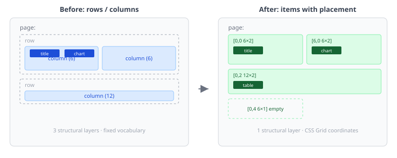
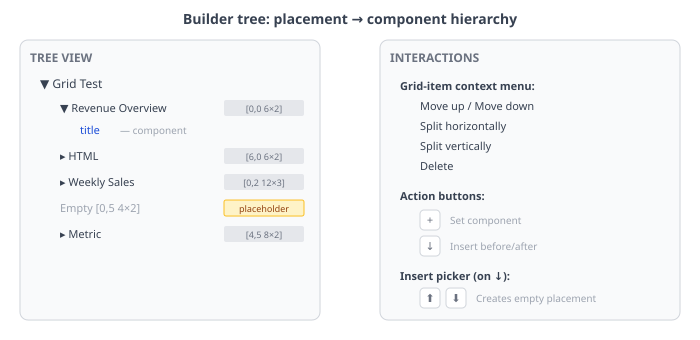

# Grid layout drops a dimension

The CaseHub Pages layout system had three ways to say the same thing: `rows` wrapping `columns` wrapping `components`, or `columns` wrapping `components`, or flat `components` with no structure. All three produced a 2D grid — but the YAML vocabulary forced you to think in terms of structural containers that didn't map to what CSS Grid actually does.

The #625 epic replaced all of it with `items` — a flat list where each entry has a `placement: { x, y, w, h }` and an optional `component`. One structural layer instead of three.



## What actually changed

A page that used to look like this:

```yaml
rows:
  - columns:
      - span: 6
        components:
          - type: title
            properties: { text: Revenue }
      - span: 6
        components:
          - type: chart
```

Now looks like this:

```yaml
items:
  - placement: { x: 0, y: 0, w: 6, h: 2 }
    component: { type: title, properties: { text: Revenue } }
  - placement: { x: 6, y: 0, w: 6, h: 2 }
    component: { type: chart }
```

The `placement` coordinates map directly to CSS Grid's `grid-column` and `grid-row`. No intermediate containers. An item with no `component` key is an empty container — a cell you can see, select, and fill later.

This matters because the builder tree, context menus, insert flows, and visual editor all had to be rebuilt. The old tree showed Row → Column → Component. The new tree shows Placement → Component. Every interaction that referenced rows or columns was dead code.

## The builder tree rebuild

The tree structure changed from three levels to two:

```
▼ Grid Test
  ▼ Revenue Overview  [0,0 6×2]    ← grid-item (expandable)
      title                          ← component inside
  ▸ HTML               [6,0 6×2]
  ▸ Weekly Sales        [0,2 12×3]
    Empty [0,5 4×2]                  ← empty container
  ▸ Metric              [4,5 8×2]
```



Grid items sort by placement position (y then x), not array order. This means inserting an item at `[0,0]` puts it first in the tree regardless of where it lands in the YAML array. The tree matches the visual layout.

Context menus were stripped of every row/column reference. A grid-item's menu has: Move up, Move down, Split horizontally, Split vertically, Delete. No "Add row", no "Wrap in Row/Column", no "Add column". The component picker was cleaned too — `rows` removed from the catalog, `grid` and `columns` hidden from grid-item insertion since the grid itself handles layout.

## Insert semantics in a 2D world

"Insert before" in a linear list is obvious — put the new thing above. In a 2D grid, it means displacement. We settled on row-level insertion: clicking ↓ → Before on a grid item creates a full-width empty container at that y-position and pushes ALL items at `y >= insertY` down by one. Not just the target — everything on that row and below.

The empty container gets a visible placeholder (a dashed box with a "+" in the centre) so you can see where it landed and click into it. The "+" button on the container opens a component picker to fill it. This is the core workflow: insert placement → fill with component. Two steps, each with a clear action.

The insert flow skips the component picker entirely for grid items. When you click ↓ on a placement, you get ⬆ (before) and ⬇ (after) — both create an empty container. No "what component?" dialog. A placement IS a container. The component is a separate concern.

## Keeping three views in sync

The builder has three views: tree, YAML editor, and visual preview. Every interaction must update all three. Clicking "Revenue Overview" in the visual preview selects it in the tree, highlights lines 4-8 in the YAML, and shows its properties in the right panel.

This required fixing `_searchComponentsForType` to traverse `page.getItems()` instead of `page.getRows()`, setting the correct `nodeType` via `classifyPath`, and resetting the selection overlay transform on every view mode switch. The overlay uses `position: fixed` with viewport coordinates so it works regardless of which panel the anchor element is in — tree panel or visual preview.

The YAML highlight had a timing issue: after a mutation, the highlight range was dispatched before the editor content synced. The positions were calculated from the new document but applied against the old editor text, causing the highlight to bleed into adjacent items. A double `requestAnimationFrame` plus calling `_updatePropertySource` after every insert fixed it.

## What's next

The drag buttons (⇵ displace, ⇄ swap) and resize edge handles are placed on every grid item but not yet wired to live drag behaviour. The grid edit controller has the pointer event handlers — the buttons need to set the drag mode and initiate the gesture. That's the next session's work (#644).

The `items` / `components` key distinction (#640) is also open. Now that rows and columns are gone, having two different keys for "children with placement" vs "children without" is unnecessary vocabulary. A single key with optional `placement` per entry would be cleaner.

The deeper question is whether the two-mode editor (Layout vs Content) still makes sense. If every panel always has drag handles and resize edges, the "enter edit mode" step is friction without value. The POC proved the interactions work — the remaining work is wiring them to the builder's mutation pathway so every drag produces an `_applyEdit('grid', ...)` that flows through undo, YAML sync, and tree rebuild.
