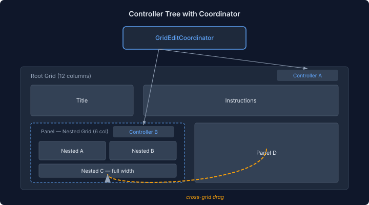
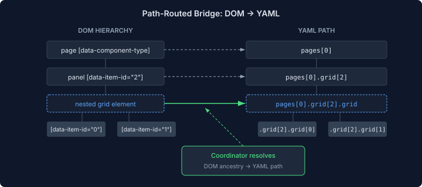

# Grids Inside Grids: Why Nested Layout Needs a Coordinator

*Follows [Grid Layout Drops a Dimension](/docs/blog/2026-11-08-mdp01-grid-layout-drops-a-dimension.md). The flat grid model worked for single-level layouts. Real applications need grids inside grids — and that broke everything.*

## The Problem No One Mentions

Every low-code platform shows the same demo: drag a chart, drop it on a grid, resize it. Looks great. Ship it.

Then someone builds an actual application. A dashboard page has a summary section at the top and a detail panel below. The detail panel itself has three charts arranged in a 2×2 grid. That's a grid inside a grid — a panel component that contains its own positioned items.

The YAML is straightforward:

```yaml
grid:
  - at: { x: 0, y: 0, w: 12, h: 2 }
    type: title
    properties: { text: Summary }
  - at: { x: 0, y: 2, w: 6, h: 4 }
    type: panel
    properties: { title: Detail View }
    grid:
      - at: { x: 0, y: 0, w: 3, h: 2 }
        type: chart
      - at: { x: 3, y: 0, w: 3, h: 2 }
        type: table
```

The data model supports it — `Component` has a `grid` property, `renderNode` recurses into it, CSS Grid handles the rest. But the edit controller was built for a flat world.

## What Broke

Three things, each depending on the one before.

**The singleton.** `GridEditController` used a module-level `activeController` variable — only one controller could be active at a time. When the runtime attached a controller to a nested grid, it silently displaced the parent's controller. Drag a panel in the parent grid? Silent failure — the controller belongs to whoever rendered last.

**The bridge.** Every `pages-grid-edit` event was routed to `doc.getPages()[0].getItems()` — the root page's items array. A drag inside the nested grid would fire an event with indices `[0, 1]`, and the bridge would mutate the root items at those indices. Wrong array, wrong items, wrong result.

**The boundary.** Even if both problems were fixed, there was no way to drag an item from the nested grid to the parent grid. The two grids were independent DOM subtrees with independent coordinate systems. An item 3-wide in a 6-column nested grid means something different from 3-wide in a 12-column root grid.

## The Coordinator Pattern

The fix is a coordinator that sits above individual controllers.



Each grid element gets its own `GridEditController` — the existing 877-line controller that handles single-grid DnD, resize, split, merge. None of that code changes. The coordinator adds three capabilities:

**Tree awareness.** Controllers register with the coordinator on construction. The coordinator discovers parent-child relationships by DOM containment — if controller B's grid element is a descendant of controller A's grid element, B is a child of A. The tree rebuilds lazily on add/remove, never during drag.

**Path resolution.** For the bridge to mutate the correct YAML array, it needs to know which grid fired the event. The coordinator walks the DOM from a grid element upward, collecting `data-item-id` attributes, and reconstructs the YAML path: `["pages", 0, "grid"]` for the root, `["pages", 0, "grid", 2, "grid"]` for the nested grid inside item 2.



**Cross-grid drag.** When a drag crosses a grid boundary, the coordinator detects the transition (the pointer leaves one grid's bounding rect and enters another's), tells the source controller to release the item, computes proportional scaling, and tells the target controller to show a placeholder. The width scales proportionally — a 3-wide item in a 6-column grid (50%) becomes a 6-wide item in a 12-column grid (still 50%). On drop, the coordinator dispatches a single atomic event: remove from source array, insert into target array, one undo step.

## Why Not Just One Controller?

The obvious alternative: one controller that manages the entire grid hierarchy. Flatten all items into one map, tag each with its grid path, handle everything centrally.

This would have meant rewriting 877 lines of well-tested drag, resize, and compaction logic. The existing controller handles displacement animation (FLIP), row-aware snapping, swap mode, resize from 8 edge/corner handles, multi-select, keyboard shortcuts. None of that needs to know about nesting.

The coordinator pattern preserves all of it. Individual controllers handle their grid exactly as before. The coordinator adds the cross-grid layer as a separate concern. If the coordinator breaks, single-grid editing still works.

## The Parsing Surprise

Building the coordinator surfaced a separate bug: the YAML parser only handled `type: "grid"` components for nested grid items. A `type: "panel"` with a `grid:` property fell through to the "unknown component" fallback, rendering as an empty box.

The fix was a generic component handler in the parser's desugar pipeline — any component type with a `grid:` property now gets its items parsed and rendered correctly. Not a nested-grid problem specifically, but invisible until nested grids were actually used.

The tree view had a similar gap. `ComponentNode.isContainer()` only returned true for explicitly registered container types. A panel with inline grid items was invisible to the tree builder. The fix: detect `grid:` presence dynamically, promote nested grid items as direct children in the tree.

## What This Enables

Nested grids are the structural primitive that turns a layout editor into an app builder. A page can have regions — a header, a sidebar, a content area — where each region has its own grid with independent drag, resize, and compaction. Regions can be nested arbitrarily deep.

Cross-grid drag means users aren't locked into a layout decision. Move a chart from the sidebar into the main content area. Drag a metric out of a detail panel into the summary section. The coordinator handles the proportional scaling and YAML mutation automatically.

The architecture is designed for arbitrary depth, not just parent-child. A grid inside a grid inside a grid works — the coordinator walks the tree to the deepest match under the pointer. In practice, two levels covers most use cases. Three levels covers the rest.

## The Remaining Work

The infrastructure is in place — coordinator, path resolution, cross-grid drag state, atomic bridge mutations, proportional scaling. What remains is wiring and polish: connecting the coordinator's pointer handoff into the controller's drag loop, visual feedback during cross-grid transit, and a thorough audit of the tree view and preview rendering. The next session is a debugging pass — systematic, visual, in the browser.

---

*This is the fourth entry in the grid editing series. Previous: [Grid Layout Drops a Dimension](/docs/blog/2026-11-08-mdp01-grid-layout-drops-a-dimension.md), [From Grid Editor to App Builder](/docs/blog/2026-11-07-mdp01-tetris-not-pixels.md), [When Custom Stops Being an Advantage](/docs/blog/2026-11-06-mdp01-when-custom-stops-being-an-advantage.md).*
