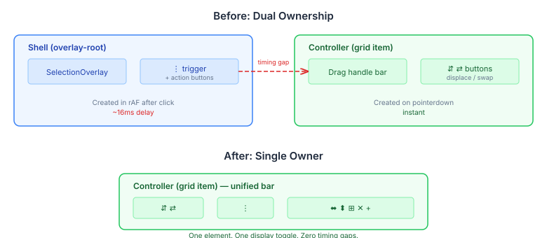
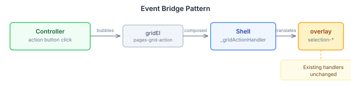

# One Element, One Toggle

The grid editor had a visual bug that looked trivial: the ⋮ menu trigger persisted after moving the mouse away from a selected item. The drag handles (⇵ ⇄) disappeared correctly. The ⋮ didn't. Four fix attempts and a revert later, I realised the bug wasn't in the hide logic. It was in the architecture.

## Two Parents, One Child

The grid editing UI had two sets of controls for the same selected item, created by different components at different times.

The **drag handle bar** — displace and swap buttons — lived inside the grid item element itself, created by the `GridEditController` on `pointerdown`. Instant. The controller toggled it with a single `bar.style.display` assignment whenever the hover state changed.

The **⋮ trigger** with its action buttons (split, merge, delete) lived in the `SelectionOverlay`, created in `.overlay-root` — a sibling of the preview container. The shell positioned it via `_applyPreviewHighlight`, which ran inside a `requestAnimationFrame` callback triggered by the click handler's 200ms double-click disambiguation timeout.



The timing gap between `pointerdown` (immediate) and `rAF-after-click` (~216ms) meant drag handles appeared first, the selection rectangle slid over, and the ⋮ trigger showed up last. They looked like they belonged to different interactions.

## Why Patching Didn't Work

I tried four fixes before the revert, each addressing a symptom rather than the structure.

The first attempt hid the overlay on grid-origin edits. Too aggressive — it killed the overlay on every grid operation, including ones where you want it to persist.

The second cleared the overlay path. Same problem — the selection state was gone when the overlay needed it back.

The third tried to make the shell the sole overlay owner, removing the controller's post-drag re-show logic. But for within-grid edits, `_syncViews('grid')` deliberately skips `_refreshPreview()` to avoid destroying the DOM. With the controller no longer re-showing the overlay, nobody did.

The fourth extended `_toggleDragHandles` to also toggle the ⋮ trigger inside `.builder-scope-overlay`. This introduced a new problem: the ⋮ trigger sat in `.overlay-root` (with `pointer-events: auto`), while the drag handles sat inside the grid item. Moving the mouse from the grid item to the trigger area fired `pointerleave` on the grid, which toggled both off. The trigger vanished under the cursor.

Each fix revealed a new edge of the same structural problem: two components sharing write access to overlapping visual state, with no coordination protocol between them.

## The Fix: Merge the Elements

I moved the ⋮ trigger and its action buttons into the controller's drag handle bar. One DOM element for all grid-item controls.

The bar layout uses `justify-content: space-between` — drag mode buttons on the left, ⋮ with its expandable action grid on the right. `_toggleDragHandles` is back to a single line:

```typescript
bar.style.display = show ? "flex" : "none";
```

No overlay queries. No timing coordination. No `pointer-events` conflicts between sibling DOM branches. The entire control surface appears and disappears in one operation because it is one element.

The `SelectionOverlay` still draws the selection outline (the blue rectangle) for grid items, and still creates the full toolbar for non-grid-item node types (pages, columns, components) where there is no grid controller. The split is clean: the overlay owns the visual selection indicator, the controller owns the interactive controls.

## The Event Bridge

The action buttons previously dispatched `selection-split-h`, `selection-merge` and similar events on the overlay root, where the shell had listeners wired up. With the buttons now inside the grid item, those events need a different path.



The controller dispatches a `pages-grid-action` event on the grid element with `bubbles: true` and `composed: true`. The shell catches it and translates:

```typescript
private _gridActionHandler = (e: Event) => {
  const { action } = (e as CustomEvent).detail;
  if (!this._selectedPath || !this._selectedNodeType) return;
  const overlayRoot = this.shadowRoot
    ?.querySelector('.overlay-root') as HTMLElement | null;
  if (!overlayRoot) return;
  overlayRoot.dispatchEvent(new CustomEvent(`selection-${action}`, {
    bubbles: true,
    detail: { path: this._selectedPath,
              nodeType: this._selectedNodeType },
  }));
};
```

The existing `selection-*` handlers on the overlay root don't change. The bridge adds one indirection but keeps the existing wiring intact — no cascading changes through the shell's event handlers.

## Fixing the Selection Rectangle Delay

With the controls unified, the remaining timing issue was the selection rectangle itself. Clicking a new item triggered a 200ms `setTimeout` (for double-click disambiguation) before setting `_selectedPath`, then `_highlightPreviewNode` wrapped `_applyPreviewHighlight` in another `requestAnimationFrame`. The rectangle didn't start moving until ~216ms after the click.

The fix: call `_applyPreviewHighlight` synchronously in the click handler, before the timeout. The path and node type are already resolved at that point — the timeout only needs to defer the `_selectedPath` state update (for the double-click check, which clears or changes the selection). The rectangle starts sliding immediately.

The drag handle bar then delays its own appearance by 150ms on new selection, matching the overlay's `transition: all 0.15s ease`. The rectangle slides to position and the controls appear when it arrives. On re-hover of the already-selected item, controls show instantly — the rectangle is already there.

## The Principle

When two components need to show and hide visual elements in lockstep, the first question is whether they should be the same element. Coordination protocols between independent DOM branches — timeouts, data attributes, `:hover` checks across shadow boundaries — are complexity that evaporates when the elements share a parent.

The grid editor's ⋮ trigger and drag handles looked like separate concerns because they originated from separate packages (`pages-builder` and `pages-component`). But the user sees one thing: controls that appear when hovering a selected item and disappear when leaving. Splitting that across two DOM owners, two event lifecycles, and two timing mechanisms created a bug surface that couldn't be patched — only restructured.
