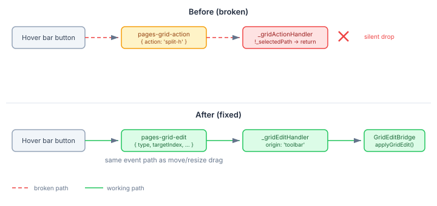

# When Events Miss Their Target

The grid editing demos — Color Grid, Content Layout, Two Forms — lived as a standalone Vite app inside `packages/pages-builder/demo/`. The task was to migrate them into the showcase gallery so every example lives in one place, browsable and searchable.

The gallery understands `.page.yaml` files. Each sample is a YAML page definition that the runtime renders. Some samples have a companion `.ts` file — the gallery fetches it, strips the type annotations, and runs it through `new Function()`. The existing Grid Builder sample in the Layout category already proved the pattern: the YAML creates a mount point, the companion script waits for `pages-builder-shell` to register as a custom element, then mounts one into it.

I followed that pattern for all three demos. The YAML data moved from inline TypeScript template literals to static files in an `includes/` directory — single source of truth for both the gallery entries and a standalone page with tab switcher. The companion `.ts` scripts are identical except for mount ID and YAML path. That duplication is unavoidable — the gallery's `new Function()` loader can't share modules between samples.

## The full-bleed problem

The gallery wraps every sample in a page-level grid with `padding: 16px`. For charts and tables that's fine. For a builder shell that should fill its container, it means a visible gap on all four sides.

The gallery has a `full-bleed` CSS class that zeroes the padding and switches to flex layout. It auto-detects `pages-dock-workbench` or `pages-graph-canvas` in the rendered content and applies it. The catch: that detection runs after the page YAML renders, before the companion `.ts` creates the builder shell. By the time the shell exists, the check has already passed.

The fix is in two parts. The companion script applies `full-bleed` after mounting the shell. And the `full-bleed` CSS needed two additions — `padding: 0 !important` on the page wrapper div (the runtime injects inline `padding: var(--pages-space-4, 16px)` which normal CSS can't override), and zeroing the page grid's own padding and gap.

## The event architecture bug

While testing, the grid editing action buttons — split horizontally, split vertically, merge, delete, add empty — did nothing when clicked. No error, no console message, no visible effect.

The hover bar on each grid item has a kebab menu that expands into a 3x2 action grid. Those buttons dispatched a `pages-grid-action` event carrying only `{ action: 'split-h' }` — just the action name, no item identification. The builder shell's handler for that event checked `this._selectedPath` to know which item to operate on. But `_selectedPath` is set by a click handler on the preview with a 200ms debounce, and the hover bar creates a separate interaction path that doesn't go through it. The result: a silent early return.

This was two independently reasonable decisions creating a dead path. The hover bar dispatches an action name because it doesn't know the YAML document structure — it only knows grid item IDs. The shell handler uses `_selectedPath` because that's how tree-initiated operations identify their target. Neither subsystem is wrong; they just don't compose.

The fix: the hover bar now dispatches `pages-grid-edit` directly — the same event that move and resize already use — with the full edit detail including item index. Split sends `{ type: 'split', targetIndex: 0, direction: 'horizontal' }`. Delete sends `{ type: 'remove', index: 0 }`. Merge dispatches `pages-grid-merge` to activate the two-step merge interaction. This bypasses the `_selectedPath` dependency entirely.

But that alone didn't make the preview update. The `_gridEditHandler` classified every edit that wasn't `'insert'` or `'merge'` as origin `'grid'` — and `_syncViews` skips `_refreshPreview()` for grid-origin edits. That's correct for move and resize, where the drag interaction already updates the visual state. For split and delete, which add or remove DOM elements, the preview needs a full refresh. The fix inverts the default: only move and resize get `'grid'` origin, everything else gets `'toolbar'`.

## What this surfaces

The pattern — silent failure when two subsystems assume different context — is worth watching for. The hover bar assumed selection state would exist. The handler assumed the event would carry a path. Both assumptions were invisible at their callsite. No error, no warning, no type mismatch. Just a guard clause returning early.

Adding the action buttons to the hover bar was a UI decision. Routing them through `_selectedPath` was a wiring decision. Neither person saw the other's assumption. The fix isn't architectural — it's just routing the event along the path that already works for the same data. But the diagnostic journey to find it required tracing custom events across shadow DOM boundaries, checking `composed: true` propagation, and verifying that the document model changed even when the view didn't update.

The gallery now has a Grid Editing category with all three demos. The builder fills edge to edge. Split, delete, merge, and add-empty work from the hover bar. The standalone page at `grid-editing.html` offers the same demos with a tab switcher for quick iteration outside the gallery.
