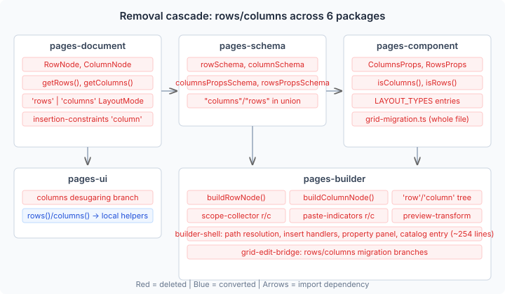
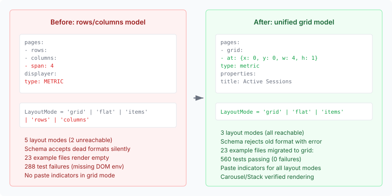

# Finishing what the grid started

The [grid model redesign](2026-11-08-mdp01-grid-layout-drops-a-dimension.md) from #625 replaced rows and columns with coordinate-based items — but it didn't remove the old code. The parser stopped handling `rows:` pages, the builder tree stopped rendering row/column nodes, the new `items:` path worked end to end. But `RowNode`, `ColumnNode`, their schema validators, their type guards, their builder traversal logic — all of it sat there, exported, importable, theoretically callable. Dead code that the type system still thought was alive.

#674 finished the job. Every remnant of the rows/columns model is gone from the TypeScript runtime. The net result: about a thousand lines deleted across six packages, seven YAML files migrated, and a type system that no longer lies about what the platform supports.

## The archaeology problem

The obvious files were obvious. `RowNode` and `ColumnNode` lived in `page-document.ts`. Their Zod schemas lived in `document-schema.ts`. The type guards `isColumns()` and `isRows()` lived in `type-guards.ts`. Delete those, and you've handled maybe a third of the references.

The rest required tracing every import chain. `pages-document` exports `RowNode`, which `pages-builder` imports for tree rendering, scope collection, paste indicators, preview transforms, and path resolution. `pages-schema` exports `columnsPropsSchema`, which `pages-ui` re-exports, which the DSL `builders.ts` uses to construct dock-workbench layouts. The `insertion-constraints.ts` file had `'column'` as a valid parent type. The component catalog had a `'columns'` entry. The layout renderer had CSS cases for both types.



Six packages touched, each with its own barrel exports, re-exports, and test files. A type removed from `pages-component` would surface as a compile error in `pages-builder` — but only after `pages-schema` also compiled clean, because Yarn workspaces build in dependency order.

## The dock-workbench surprise

Most of the deletion was mechanical. Remove the type, follow the compile errors, delete or update. One case wasn't.

The dock-workbench DSL — the code that builds complex split-pane layouts with side panels, centre content, and status bars — used `rows()` and `columns()` as exported builder functions. These weren't just creating `type: "rows"` components for page layout; they were constructing the internal structure of the workbench itself.

```typescript
// Before: relied on the layout type system
export function rows(...children: Component[]): Component {
  return freeze({ type: "rows", slots: { default: children } });
}

// After: local helper, inline styles, type: "panel"
function rows(...children: Component[]): Component {
  return freeze({
    type: "panel",
    style: freeze({ display: "flex", "flex-direction": "column" }),
    slots: freeze({ default: freeze(children) }),
  });
}
```

The fix was straightforward once I understood the dependency. The dock doesn't need `type: "rows"` to exist in the layout type registry. It needs a container that renders as a flex column. A `type: "panel"` with inline styles does the same thing without polluting the type system with layout primitives that only the dock uses.

The `columns()` builder got the same treatment: `type: "panel"` with `display: grid` and computed `grid-template-columns` from the distribution array. The functions went from exported to local, and the dock kept working.

## What actually gets deleted

The cascade across packages:

| Package | What was removed |
|---------|-----------------|
| **pages-document** | `RowNode`, `ColumnNode` classes, `getRows()`, `getColumns()`, `addRow()`, `insertRowAt()`, `wrapInRow()`, `'rows' \| 'columns'` from `LayoutMode`, column parent in insertion constraints |
| **pages-schema** | `rowSchema`, `columnSchema`, `columnsPropsSchema`, `rowsPropsSchema`, schema registry entries, component discriminated union entries |
| **pages-ui** | Columns desugaring branch in parser, `columns()` and `rows()` DSL exports, stale JSDoc documenting `rows:` format |
| **pages-component** | `ColumnsProps`, `RowsProps`, `isColumns()`, `isRows()`, grid migration script and tests, `LAYOUT_TYPES` entries, `applyLayoutCSS` cases |
| **pages-builder** | `buildRowNode()`, `buildColumnNode()`, row/column traversal in scope-collector, paste-indicators, preview-yaml-transform, path resolution, catalog entry, property panel cases |
| **YAML files** | 7 source files migrated from `rows:` / `columns:` / `span:` to `grid:` with `at: {x, y, w, h}` |

The migration script itself — `grid-migration.ts` — was deleted last. It had already done its job converting the server example files in an earlier session. This time it guided the conversion of the remaining backend test resources and layout includes, then it was removed alongside its test file.

## Why this matters beyond cleanup

The old model wasn't just extra code. It was a lie the type system told every consumer.

`LayoutMode = 'grid' | 'flat' | 'items' | 'rows' | 'columns'` meant every `switch` on layout mode had to handle five cases. Two of those cases were unreachable — the parser no longer produced them. But the type system demanded handlers, and developers who read the types would reasonably conclude that rows and columns were supported.

Worse, the `pageEntrySchema` Zod validator accepted `rows:` and `columns:` in YAML, so a page author could write perfectly valid YAML that would parse to an empty grid with no error. Silent failure, type-sanctioned.

After the removal, `LayoutMode = 'grid' | 'flat' | 'items'` — three values, all reachable, all rendered. The schema rejects old-format YAML with a validation error. The type system matches reality.

## The last mile

The runtime was clean. The types were honest. But two things still used the old vocabulary.

The examples repo (`casehubio/examples`) had 23 `.dash.yaml` domain samples — clinical dashboards, IoT fleet monitors, sales analytics, Prometheus metrics, Backstage integration — all still using `rows:` / `columns:` / `span:`. With the runtime removal landed, these files would render as empty grids. No error, no fallback, just nothing.

The conversion is mechanical but not trivial. Each `rows:` block maps to a `grid:` block where the row index becomes the `y` coordinate, column spans become widths in the 12-column grid, and the old `displayer:` wrapper unwraps into the new `type:` / `properties:` format. A Python migration script handled the structural transformation. The yaml library reformats whitespace and string styles on round-trip — semantically identical output, just tidied.

The other gap was in the builder itself. `yaml-paste-indicators.ts` — the code that marks valid paste locations in the YAML code editor — only handled `mode === 'flat'` pages. Grid and items mode pages got a child entry on the page node but no sibling entries alongside individual items. If you were editing a grid page's YAML and tried to paste a component, the paste location markers wouldn't appear next to existing items.

The fix is seven lines. The function already knew how to generate sibling entries — it just needed an `else if (mode === 'grid' || mode === 'items')` branch that iterates `page.getItems()` instead of `page.getComponents()`. The path construction mirrors the document model: `['pages', pi, key, ii]` where `key` is `'grid'` or `'items'` depending on the layout mode.

## The invisible infrastructure

Nine renderer test files in `pages-component` — covering grid editing, slot swapping, layout CSS, interactive wiring, split panels, grid merging, and grid coordinate math — all used raw DOM APIs but ran without a DOM environment. Every test in these files failed with `ReferenceError: document is not defined` when invoked from the repo root.

Two files (`grid-edit-controller.test.ts` and `selection-overlay.test.ts`) already had the `// @vitest-environment jsdom` directive from a prior fix. The other nine didn't. The fix was one line per file, applied across all nine. The renderer test suite went from 288 failures to zero — 560 tests passing.

This is the kind of infrastructure gap that compounds silently. The tests existed, the assertions were correct, the coverage was real. But running `npx vitest run packages/pages-component/src/renderer/` from the repo root reported twenty failing test files, and anyone who saw that output would reasonably conclude the renderer was broken. It wasn't. The tests just couldn't see the DOM.



The unified grid model is now genuinely landed. Not just merged — the old format is rejected by the schema, absent from the type system, absent from the examples, and every test that covers the new model actually runs.
