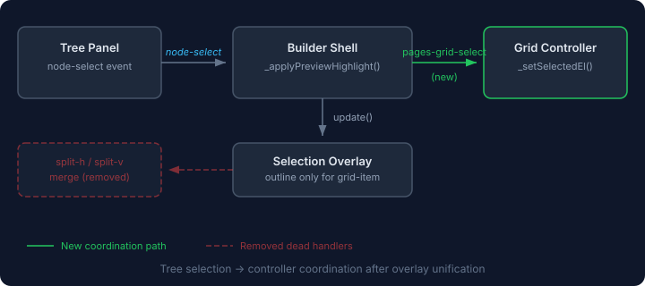

# The small things that make a builder usable

Four issues. No new features. No architectural changes. Just a visual builder becoming incrementally less annoying to use.

The overlay unification in #653 moved grid-item action buttons from the selection overlay into the grid controller's own handle bar. That was the right call — the overlay had no business managing grid-specific drag modes. But it left behind orphaned event handlers in `builder-shell.ts` that listened for `selection-split-h`, `selection-split-v`, and `selection-merge` events that nothing dispatched anymore. The overlay's `ALL_BUTTONS` array had been reduced to add, insert, cut, copy, delete — split and merge never appeared. Ninety-two lines of code that did nothing, plus a test suite asserting that nonexistent buttons existed on grid items.

That was #670. Pure deletion, satisfying in the way cleanup always is when you can prove the code was dead before you touched it.

## The coordination gap

The more interesting fix was #661. After the overlay unification, selecting a grid item via the tree panel showed the blue selection outline — but nothing else. No drag handles, no ⋮ trigger, no action buttons. The outline came from the selection overlay, which correctly positioned itself around the item. The handle bar came from the grid controller's `_setSelectedEl`, which only fired on pointer events within the grid.

The tree and the controller had no coordination path.

The fix adds a `pages-grid-select` custom event. When `_applyPreviewHighlight` processes a `grid-item` node type, the builder shell finds the nearest `[data-grid-editing]` ancestor and dispatches `pages-grid-select` with the item ID. The controller listens for it in both `enterPassive()` and `enter()`, calls `_setSelectedEl`, and immediately shows the handle bar.

The lifecycle needed care. `enterPassive()` adds the listener when the grid first renders with positioned items. `enter()` adds it again when switching to active edit mode — but `addEventListener` with the same function reference is a no-op per the DOM spec, so the double-add is harmless. `exit()` removes it once. The symmetry holds because `dispose()` calls `exit()`, and `enterPassive()` sets `_active = true`, so `exit()` always runs its full cleanup path.

## The visibility details

The other two fixes are smaller but arguably more impactful for day-to-day use.

#663 was a test infrastructure gap. `grid-edit-controller.test.ts` and `selection-overlay.test.ts` both use raw DOM APIs — `document.createElement`, `getBoundingClientRect`, `querySelector`. Both packages have `environment: 'jsdom'` in their vitest config. But running the tests from the repo root (which has no root vitest config) meant jsdom never loaded. The fix is a `// @vitest-environment jsdom` directive at the top of each file — belt and suspenders that makes them work regardless of invocation context.

#651 was about contrast. The tree view's coordinate badges — `[0,0 4×2]`, `[4,0 8×2]` — used `color: var(--pages-neutral-11); opacity: 0.7`. On a dark background, that's nearly invisible. The fix drops the opacity entirely and uses `--pages-neutral-8`, which sits at a readable mid-range in the OKLCH 12-step scale. The selection overlay's toolbar buttons used hardcoded `#fff`, `#5f6368`, and `#dadce0` — Google Material colours that made sense in a light-only prototype but broke in any other theme. Replaced with `--pages-neutral-2`, `--pages-neutral-11`, and `--pages-neutral-6`.

The most visible change: grid items in the preview now have `outline: 1px dashed var(--pages-neutral-5)`. Before this, the preview showed text running into text with no visual separation between items. The dashed outlines are subtle enough that the content stays dominant, but they give the builder the spatial awareness it needs. You can tell where one component ends and the next begins without having to click anything.

## Why this work matters

A visual builder that doesn't show you its structure isn't a builder — it's a text editor with a live preview bolted on. The tree panel, the preview outlines, the action buttons — these are the feedback loops that make drag-and-drop, insert-at, and split/merge feel like direct manipulation instead of guesswork. When any of those loops break, users fall back to editing YAML directly, which defeats the purpose of having a visual mode.

The four fixes on this branch tightened those loops. Dead handlers removed so the event surface is honest. Tree selection wired to the controller so actions appear where the user is looking. Test infrastructure fixed so the overlay and controller tests run everywhere. Hardcoded colours replaced with design tokens so the builder works in the theme it's deployed under.

None of it is exciting. All of it makes the builder marginally more trustworthy — and trust is what determines whether people stay in visual mode or switch back to source.
