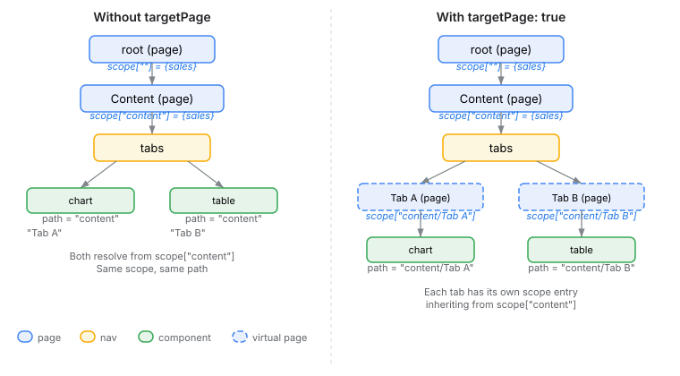

# The property nobody read

Twelve YAML samples declared `targetPage: true` on their tabs components. The runtime ignored every one of them. The property passed through desugaring as an inert prop, was stored on the component, and was never consumed by anything. No code read it. No code path branched on it. It sat there, decorative, while the tab content rendered the same way it would have without it.

The issue said datasets weren't resolving for `targetPage` tab content. I spent a good chunk of the investigation convinced there had to be a subtle scoping bug — something in the lazy rendering path that created new Component objects, breaking the identity-based `PagePathMap` lookup. Or maybe a timing issue where the scope wasn't ready when the data request fired.

None of that was true.

## What the scoping actually does

The dataset scope system in Pages is hierarchical. `buildDataSetScope` walks the component tree, and for every `type: "page"` component it finds, it creates a scope entry that inherits all datasets from the parent page plus any the page defines itself. `resolveDataSetEntry` then walks up the path hierarchy — `"content/Tab A"` checks `scope["content/Tab A"]`, then `scope["content"]`, then `scope[""]` — until it finds the dataset.

Tab content components, being non-page elements, inherit their parent page's path. A chart inside a tab slot gets `pagePath = "content"`, and `scope["content"]` has the root datasets. The resolution works fine. I confirmed this by writing unit tests that model the exact Polling sample structure, and by loading the gallery in a browser — zero console errors across all three tabs.

So the existing scoping was correct. The problem was that `targetPage: true` was supposed to change the behaviour, and it didn't.

## What targetPage is for

The intent behind `targetPage: true` is that each tab should be treated as a virtual page. Not just visually — structurally. Each tab gets its own page path in the page-path map, its own scope entry in the dataset scope, and its own namespace for things like save configs and data scopes.

Without it, all tabs share the parent page's identity. With it, "Tab A" becomes `"content/Tab A"` — a first-class page in the hierarchy.



The fix lives in `component-desugar.ts`, the step that transforms raw YAML component declarations into the internal Component tree. When a navigation component (tabs, pills, carousel, etc.) has `targetPage: true` in its properties, the desugar now wraps each slot's children in a virtual page component:

```typescript
if (slots && props?.targetPage === true) {
  for (const [name, children] of Object.entries(slots)) {
    slots[name] = [{
      type: "page",
      props: { name },
      slots: { default: children },
    } as Component];
  }
}
```

Eleven lines. The property is consumed and stripped from the nav component's props. Everything downstream — page paths, scope building, scope resolution, lazy rendering — works unchanged because the machinery was already there. The virtual pages are ordinary page components; the runtime doesn't know or care that they were synthesised during desugaring.

## Why the investigation mattered

I could have jumped to the implementation. The YAML property exists, it should do something, make it do that thing. But the issue reported a dataset scoping failure, and I wanted to understand whether the existing scoping was broken before adding new behaviour on top of it.

The investigation confirmed two things: the hierarchical scope inheritance is correct, and the lazy rendering path preserves Component object identity through tab swaps. Both of those are load-bearing properties that this fix depends on. The virtual pages inherit datasets because `walkScope` propagates the parent's scope. The tab content renders correctly because `renderSlot` passes the original Component references, so `pagePathMap.get(component)` finds the right path even for components inside virtual pages.

If either of those had been broken, the eleven-line fix would have been eleven lines of wishful thinking.

## The practical effect

Each `targetPage: true` tab now has its own page-level identity. The immediate benefit is proper dataset scoping — each virtual page inherits from its parent's scope, so root-level datasets are available everywhere they should be. But the structural change opens up per-tab data scopes, per-tab save configs, and per-tab navigation tracking, all of which key off page paths.

The visual effect is subtle: virtual pages pick up page-level styling (16px padding, flex column layout). For tabs that are supposed to feel like pages, that's the right behaviour. The YAML author opted in by setting the property.
