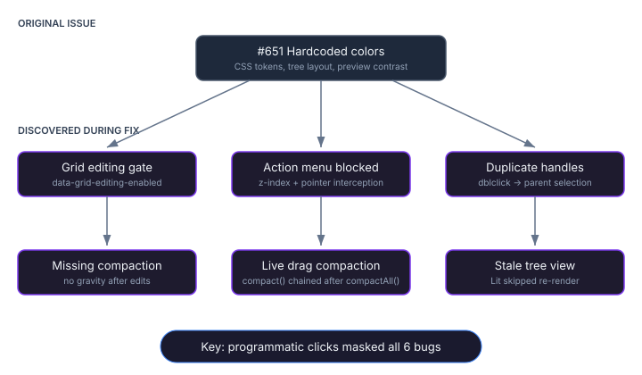
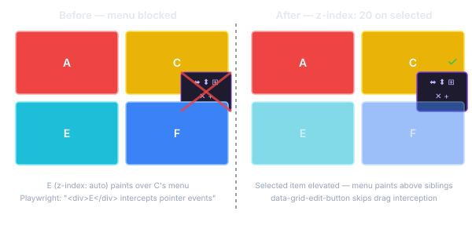

# Six Bugs Behind One Contrast Fix

I started the day with a simple issue: the builder's tree view, properties panel, and component palette used hardcoded hex colors instead of design tokens. Poor contrast in dark themes, no adaptation when switching themes. Textbook token cleanup.

By the end of the session I'd fixed six bugs in the grid editing system that had nothing to do with colors. Every one of them was invisible to programmatic testing and only surfaced through real mouse interaction in Playwright.



## The token cleanup was straightforward

The builder chrome had three categories of hardcoded colors. Non-existent custom properties like `--pages-input-bg` and `--pages-chip-bg` that always fell through to their hex fallbacks. Fully hardcoded values like `#4285f4` (Google blue) in the YAML editor gutter. And hex fallbacks on valid tokens that the property palette didn't need — the token system works, the tree view already proved it.

Ten files, mechanical replacements. The kind of change where the diff is boring and the before/after screenshot tells the whole story. I also restructured the tree view's action buttons — they were invisible (`opacity: 0`) but still occupied 80–96 pixels of flex space, creating a gap between the label and the right edge. Wrapping them in an absolutely-positioned container let the labels fill the full width, with buttons overlaying on hover.

## Then I tried to click a grid cell

With the contrast fixed and the tree looking right, I opened the visual preview to verify the grid editing controls. No drag handles appeared. No triple-dot action menu. Nothing.

The root cause: a recent commit had gated grid controller activation behind a `data-grid-editing-enabled` attribute to prevent editing controls from leaking into the gallery and showcase pages. The comment in the code said "The builder sets this attribute" — but the builder never did. One line in `_refreshPreview` fixed that:

```typescript
container.dataset.gridEditingEnabled = '';
```

Handles appeared. I could select cells, see the drag buttons, expand the action menu. The ⋮ trigger opened, the split/merge/delete buttons were visible. So I clicked Split.

Nothing happened.

## The gap between programmatic and real clicks

I spent time proving the split DID work — programmatic `element.click()` via Playwright's evaluate fired the event, the bridge modified the YAML, the editor updated. The split was real. But clicking the same button with a real Playwright mouse — `page.getByTitle('Split horizontally').click()` — did nothing.

Playwright's error message was the breakthrough:

```
<div>E</div> intercepts pointer events
```

Cell E, sitting directly below cell C in the grid, was painted on top of C's action menu. The action buttons expanded downward from the ⋮ trigger and landed in E's visual space. Because the selected grid item had no z-index elevation, sibling items in later DOM positions painted above its absolutely-positioned children.



This is a class of bug that programmatic clicks can never catch. `element.click()` bypasses the browser's hit-test pipeline entirely. It fires the click event directly on the target element. No z-index check, no pointer-events check, no "is this element actually visible and reachable by a mouse cursor" check. The event handler runs, the YAML changes, the test passes. But a real user's mouse lands on a pixel coordinate, and the browser decides which element is at that coordinate. If it's E instead of the Split button, the click never reaches the button's handler.

The fix had two parts: adding `data-grid-edit-button` to the action buttons so the controller's `handlePointerDown` wouldn't treat them as drag starts, and setting `z-index: 20` on the selected grid item so its handle bar paints above siblings.

## Gravity wasn't working

With action buttons functional, I tested delete. The item vanished from the grid and the YAML. But the items below the deleted cell didn't move up. No gravity, no compaction.

The grid editing bridge — the layer between the controller's events and the YAML document model — called `page.removeItem()` and stopped. It never ran compaction. Same for merge. Same for move and resize. The `compact()` function existed in `grid-compaction.ts`, tested and working. Nobody called it after destructive operations.

I added a `_compactGrid` helper to the bridge and called it after remove, merge, and move/resize. For moves, I also had to remove a guard that skipped the preview refresh for grid-origin edits — the controller updates the visual state live during drag, but after drop, the compacted positions need to re-render.

Then the user asked why compaction only happened after drop, not during drag. During a displace drag, the controller runs `compactAll` to place the dragged item at the target and push others down. But `compactAll` is `place + compactDown` — it never runs `compact` (upward pull). Items in the vacated space floated until drop. Chaining `compact()` after `compactAll()` in the pointer move handler gave live upward compaction — items fill gaps the moment the dragged cell moves away.

## Two more bugs fell out

**Double-click produced duplicate handles.** Clicking a cell showed its drag handle bar. Double-clicking to select the parent container showed the parent's selection but left the child's handles in place. The `dblClickHandler` updated `_selectedPath` to the parent without calling `_applyPreviewHighlight`, which is what clears the old selection's visual state. And selecting a non-grid-item (like a page node) never told the grid controller to deselect — no `pages-grid-select` event with an empty `itemId` was dispatched.

**The tree view went stale after edits.** Split a cell, and the tree still showed the old item count with original annotations. The tree component subscribes to `document.onChange()` and rebuilds its model, but `_syncTree()` passes the same document reference via Lit's `litRender`. Lit's property diffing sees the same object and skips the update. The fix: explicitly call `_rebuildModel()` on the tree component after rendering it.

## What I'd want someone building a grid editor to know

Test with real mouse events, not programmatic clicks. `element.click()` is a lie — it tells you the handler works, not that the handler is reachable. Playwright's locator-based `.click()` goes through the full browser hit-test pipeline, which is where z-index stacking, pointer-events CSS, and element overlap actually matter.

Grid compaction is not optional. If your editor supports delete, merge, split, or move, every operation needs a compaction pass. Users expect gravity — items should fill gaps immediately, not on the next unrelated interaction.

Live compaction during drag is the difference between feeling responsive and feeling broken. The layout change happens when space opens up, not when the mouse releases. For the implementation: compose your compaction functions. `compactAll` (place + push down) followed by `compact` (pull everything up) gives you displacement at the target AND gap-filling at the source in one pass.

And watch your stacking contexts. An absolutely-positioned child inside a grid item with `z-index: auto` is below every sibling that comes later in the DOM. The selected item needs elevation. Clean it up on deselect.
