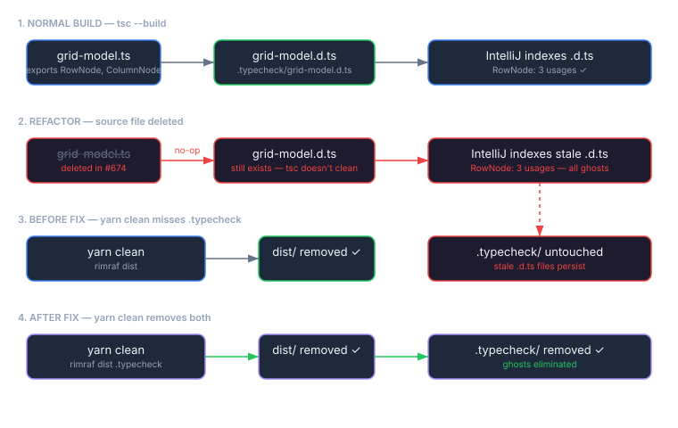

# The Ghosts in .typecheck

You delete a source file. The build passes. The tests pass. CI is green. But IntelliJ still shows three usages for a type that no longer exists. You click one and land in a `.d.ts` that declares an interface the codebase abandoned weeks ago. This is the ghost reference problem, and in a TypeScript monorepo, it's quietly waiting for anyone who relies on `tsc --build` for incremental compilation.

## How TypeScript incremental builds create ghosts

Every package in this monorepo has a `tsconfig.json` with:

```json
{
  "compilerOptions": {
    "outDir": ".typecheck",
    "emitDeclarationOnly": true
  }
}
```

This tells `tsc --build` to emit `.d.ts` declaration files into a `.typecheck/` directory. The build is incremental — it tracks what changed via `.tsbuildinfo` and only recompiles what it needs to. When you edit `grid-model.ts`, TypeScript regenerates `grid-model.d.ts`. Fast. Correct. Exactly what you want.

But when you *delete* `grid-model.ts`, TypeScript does nothing to the corresponding `.d.ts`. The incremental engine tracks what has changed, not what has disappeared. The `.tsbuildinfo` file updates to forget the deleted source, but the orphaned declaration sits in `.typecheck/` indefinitely. TypeScript treats it as someone else's problem.

This isn't a bug — it's a design boundary. `tsc --build` is a compiler, not a build system. It transforms source files that exist; it doesn't reconcile output directories against source trees. The TypeScript team has acknowledged this behaviour and left cleanup to external tooling.

## The practical damage

In isolation, stale `.d.ts` files are harmless. They're gitignored. They don't affect compilation (TypeScript resolves from source, not from `.typecheck/`). The build doesn't read them. CI doesn't see them.

But IDEs do.

IntelliJ (and VS Code, though less aggressively) indexes everything in the project tree that isn't explicitly excluded. A `.d.ts` file declaring `RowNode` and `ColumnNode` looks exactly like a valid type definition. The IDE adds these declarations to its symbol table. Now "Find References" for any surviving type that *used* to coexist with `RowNode` in the same file returns phantom results. "Go to Definition" can land you in a file that describes an interface the codebase deleted a month ago.

For this project, the row/column grid model was removed in #674 as part of migrating to a positioned grid layout. But IntelliJ was still showing:

- `RowNode` and `ColumnNode` in pages-document
- `ColumnsProps`, `RowsProps`, `isColumns`, `isRows` in pages-component and pages-ui
- `grid-migration.d.ts` for a source file that no longer exists
- `LayoutMode = 'rows' | 'columns' | 'flat'` — the old enum, while source had moved to `'grid' | 'flat' | 'items'`

The ghost references don't cause build failures. They cause something worse: developers making decisions based on stale information. Someone checking "how many things use RowNode" sees three hits and concludes the migration isn't complete. Someone looking at `LayoutMode` sees the old definition and writes new code against a type surface that doesn't exist.



## Why not just rebuild from scratch?

The obvious question: why not change the `typecheck` script from `tsc --build` to `rimraf .typecheck && tsc --build`? That eliminates stale files by nuking the output directory before every build.

It also eliminates incremental compilation. For a monorepo with 34 packages, `tsc --build` takes under 2 seconds on a warm cache. A cold build takes 15–20 seconds. That's the difference between a typecheck you run reflexively and one you run deliberately. Incremental builds are worth keeping.

Another option: a post-build validation script that cross-references `.d.ts` outputs against source files and flags orphans. This works but adds complexity — you need to parse tsconfig references, resolve path mappings, handle re-exports. It's the kind of tooling that starts simple and accumulates edge cases forever.

## The fix that fits

The right answer is simpler. The monorepo already has a `yarn clean` command that runs each package's `clean` script. Those scripts removed `dist/` but not `.typecheck/`. The fix:

```diff
- "clean": "rimraf dist"
+ "clean": "rimraf dist .typecheck"
```

Applied across all 34 packages. For the 8 packages that didn't have a `clean` script at all, one was added. For 4 of those, `rimraf` was added as a devDependency.

This preserves incremental builds for the common case (editing source files) and provides a reliable cleanup path for the uncommon case (deleting source files, switching branches, debugging ghost references). The developer workflow becomes: if IntelliJ is showing phantom types, `yarn clean && yarn typecheck` and they're gone.

## The broader principle

Build tool incremental modes optimize for the happy path: files that change. They rarely handle the deletion path correctly, because tracking "what used to exist" requires maintaining state that the tool doesn't need for its primary job. This is true of TypeScript, but also of Webpack's cached modules, Vite's pre-bundled dependencies, and Maven's incremental compilation.

The fix is always the same: make sure your clean target knows about every output directory. When you add a new output location to your build, add it to your clean script in the same commit. The gap between "where the build writes" and "what clean removes" is where ghosts live.

For this project: 34 packages, 35 files changed, zero functional impact on the build. The only thing that changed is that `yarn clean` now means what developers expect it to mean — a clean slate, with no declarations left over from code that no longer exists.
