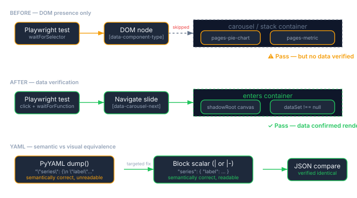

# Present but Not Proven

A test that asserts "this element exists" and a migration that declares "semantically identical" share the same failure mode: they prove the shape is right while leaving the substance unchecked. This session closed two issues that sit on opposite sides of that boundary — one in Playwright, one in YAML tooling — and both illustrate why verification needs to go one layer deeper than it usually does.

## The carousel that rendered nothing

The Carousel and Stack gallery sample had two Playwright tests. The first waited for a `[data-component-type='bar-chart']` selector and counted rendered charts. The second checked that `tabs` and `carousel` appeared in the list of `data-component-type` attributes. Both passed. Both proved the DOM tree looked right.

Neither proved that data reached the charts.

The gap comes from how the gallery's `openSample` helper works. It waits for data-ready by scanning every component in `#sample-target` and checking whether a `pages-*` custom element has a populated `dataSet` property. But it skips layout containers — tabs, carousel, stack, accordion — because those are structural wrappers, not data components. The side effect: any data component *nested inside* a layout container is invisible to the readiness check. The page loads, the bar chart DOM node exists, the test sees the node and passes. Whether echarts has drawn anything on its canvas is never verified.

The fix adds two tests that go deeper:

**Carousel slide navigation.** Click `[data-carousel-next]` to advance to the pie chart slide, then wait for `pages-pie-chart` to have a `<canvas>` in its shadow DOM. The canvas is what echarts creates when it has data and renders — no data, no canvas.

**Tab switching.** Click the Stack tab via `[data-tab-bar] button[data-slot='Stack']`, then verify the metric component has a non-null `dataSet`. This catches the case where the tab renders but the data pipeline hasn't connected the metric to its dataset.



The pattern here is general: layout containers create a nesting boundary that readiness checks need to cross explicitly. If your test framework waits for top-level components to be "ready," anything inside a lazy-rendered container (carousel slides, stack sections, accordion panels) is a blind spot. The fix isn't to make the readiness check recursive — that would slow every test for a case most samples don't have. The fix is to write targeted assertions for the samples that *do* nest data inside layout containers.

## The migration that escaped its strings

The second issue is about YAML formatting. Issue #675 migrated 23 `.dash.yaml` files from the old `rows:/columns:` layout model to `grid:` with positioned `at: {x, y, w, h}` coordinates. The migration script used Python's PyYAML library — `yaml.safe_load()` to parse, modify the structure in memory, `yaml.dump()` to write.

The output was semantically correct. Every YAML parser produces identical data from the before and after files. But PyYAML's dumper makes different formatting choices than a human would:

```yaml
# Before (human-written):
extraConfiguration: |
  "series": {
    "label": {
      "position": "top"
    }
  }

# After (PyYAML dump):
extraConfiguration: "\"series\": {\n  \"label\": {\n      \"position\": \"top\"\n  }\n}\n"
```

Both represent the same string. The block scalar (`|`) is readable. The double-quoted escape sequence is not. For a one-off migration script, this is the kind of thing you notice in the diff, wince at, and move on. But these files are documentation — example dashboards that developers read to learn the YAML format. Readability is function, not aesthetics.

The fix uses a targeted regex replacement rather than a full YAML round-trip. A round-trip through `ruamel.yaml` (which preserves much more formatting than PyYAML) still reformatted indentation and quote styles across 40 files — far more than the 7 that actually had escaped strings. The regex approach scans for double-quoted values containing `\n`, unescapes them, and writes a block scalar with the correct indicator:

- `|` when the original string ends with a newline (block scalar includes trailing newline)
- `|-` when it doesn't (strip indicator removes trailing newline)

That `|` vs `|-` distinction is the kind of detail that makes YAML formatting treacherous. A block scalar with `|` always appends a newline to the parsed string. If the original double-quoted string didn't end with `\n`, using `|` silently adds a character. The parsed data would no longer match. Every reformatted file was verified by parsing both versions with `ruamel.yaml` and comparing the JSON serialisation.

## The verification instinct

Both fixes share a principle: verification has to reach the layer where meaning lives. For the carousel tests, meaning lives in the echarts canvas, not the DOM node. For the YAML migration, meaning lives in the parsed data structure, not the file content. Checking the wrong layer gives you a test that passes and a migration that "works" — until someone actually looks at what was produced.

The practical habit: when you write a test, ask "what would have to be broken for this to still pass?" When you write a migration, ask "what would have to be wrong for the output to still parse?" The answer to those questions is where your next assertion belongs.
