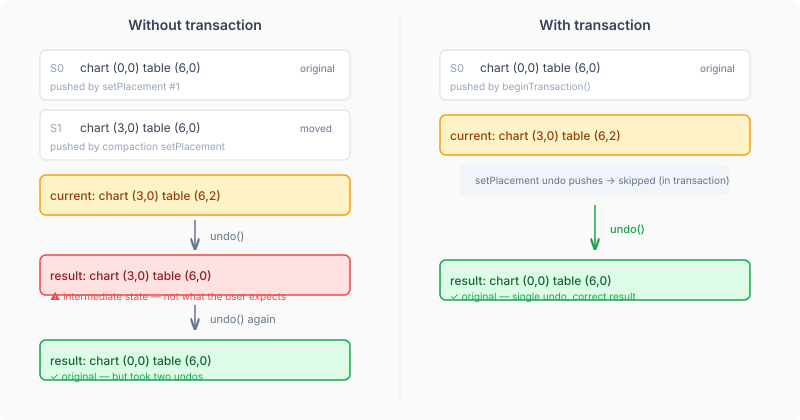
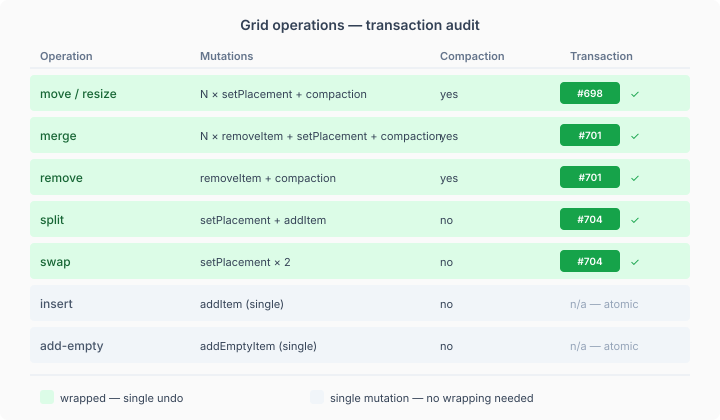

# When Improvements Break Undo

Every `setPlacement` call in the grid editor pushes an undo snapshot. That's the right design — each mutation gets its own undo entry, so Ctrl-Z reverses exactly one change. The problem arrives when you add a second mutation that runs silently after the first.

Issue #651 added compaction to the grid editor. After every move or resize, gravity pulls items downward to fill gaps — the same behaviour you see in any drag-and-drop dashboard. The implementation is straightforward: after `_applyPlacements` updates the coordinates, `_compactGrid` scans for items that can drop to a lower y-position and calls `setPlacement` again for each one it finds.

Each of those compaction `setPlacement` calls pushes another undo snapshot.

A user moves a chart panel from row 0 to row 1. Compaction notices the space above is empty and pulls it back to row 0. The grid looks unchanged. Under the surface, the undo stack now has two entries: one for the original move, one for the compaction adjustment. Press Ctrl-Z and undo reverses the compaction — restoring the panel to row 1, the intermediate position nobody saw. Press Ctrl-Z again and you get back to row 0, the actual starting point. The user sees: press undo, panel jumps somewhere unexpected, press undo again, it goes home. That's the kind of bug that makes users distrust an editor.



## The transaction fix

The fix is `beginTransaction`/`commitTransaction` — PageDocument's mechanism for grouping multiple mutations into a single undo entry. During a transaction, individual `setPlacement` calls skip undo pushes entirely. `beginTransaction` captures the pre-transaction state once. `commitTransaction` fires the change notification once. One undo press reverses everything — the move and the compaction — atomically.

```typescript
doc.beginTransaction();
try {
  this._applyPlacements(doc, detail.items, gp);
  const page = doc.getPages()[0];
  if (page && (page.getLayoutMode() === 'grid'
      || page.getLayoutMode() === 'items')) {
    this._compactGrid(page);
  }
  doc.commitTransaction();
} catch (e) {
  doc.abortTransaction();
  throw e;
}
```

The `try`/`catch` matters. Without it, a thrown exception leaves the document stuck in transaction mode — every subsequent `setPlacement` silently skips undo pushes and notification callbacks. The document looks functional but undo stops working and change listeners stop firing. `abortTransaction` restores the pre-transaction state and clears the flag.

## Completing the audit

The initial fix in #698 covered move and resize — the two operations where compaction was most visible. But the original blog entry already noted that merge and remove had the same gap. Both call `_compactGrid` after their primary mutations. Both push multiple undo entries.

Merge is the worse case. It calls `removeItem` for each item being consumed, then `setPlacement` on the surviving item to expand it to the bounding rectangle, then `_compactGrid` to close any gaps the removed items left behind. For a two-item merge, that's at least three undo entries: the remove, the placement, and the compaction. Undo reverses the compaction. Undo again resizes the surviving item. Undo a third time restores one of the removed items. The user pressed merge once and needs three undos to get back.

The fix is identical. Wrap in `beginTransaction`/`commitTransaction`, same `try`/`catch`/`abortTransaction` guard.

Then the audit found a subtler bug. When `gridPath` is set — meaning the user is editing items inside a nested grid panel — `_applyPlacements` correctly targets the nested YAML. But `_compactGrid` always runs on `doc.getPages()[0]`, the root page. After a nested grid edit, compaction runs on the wrong grid entirely. It's compacting items the user didn't touch in a grid they aren't looking at.

Currently harmless because root items rarely have vertical gaps. But "currently harmless" and "correct" are different things. The fix: skip root compaction when `gridPath` is set. The nested grid edit touches only the nested YAML; compacting the root is wrong regardless of whether it changes anything.

## What's still exposed

The audit turned up two more operations with the same multi-undo problem:



**Split** calls `setPlacement` to resize the original item, then `addItem` to insert the new half. Two undo entries. The user splits a panel, hits undo, and only the new half disappears — the original item keeps its halved dimensions.

**Swap** calls `setPlacement` twice, once for each item. Two undo entries. The user swaps items A and B, hits undo, and only B returns to its original position — both items end up at B's original location.

Neither has compaction. Neither currently produces visible glitches in most cases — swap is rare and split always feels like two operations anyway. But the undo contract is clear: one user action, one undo step. Filed as #704.

## The principle

The boundary between "one undo entry" and "many" isn't a function call boundary. It's a user intent boundary. If the user pressed one button, undo should reverse one button press. Every compound operation — anything that calls more than one mutation method — needs transaction wrapping. The mistake is easy to make: each helper method pushes its own undo entry as a reasonable default, and the composition looks correct until someone presses Ctrl-Z.
