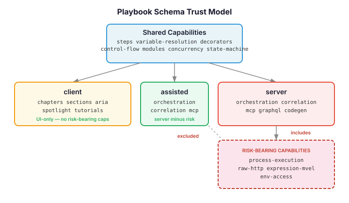

# Keeping Two Parsers Honest

The CaseHub playbook language has two parsers: a Java one in the platform and a TypeScript one in pages. They share a specification but not a codebase. When either drifts, the same YAML accepted by one parser gets rejected by the other, and the cross-parser test suite lights up like a warning board. Five platform changes had accumulated since the last sync. Time to reconcile.

## What drifted

The gap covered four areas. The trust model had grown four new risk-bearing capabilities — `process-execution`, `raw-http`, `expression-mvel`, `env-access` — plus an `assisted` schema that sits between `client` and `server`: it has the full server orchestration surface but deliberately excludes anything that can reach the host OS or external HTTP endpoints. This is the schema for AI-assisted authoring, where the LLM can compose playbooks using MCP, GraphQL, and correlation, but cannot execute shell commands or make raw network calls.



The TS code also had a stale `TRIGGERS` capability that never existed on the platform side — an artifact from an earlier iteration that survived because nothing used it.

## The for-each rename

The most pervasive change was the canonical form rename: `forEach` to `for-each`. Platform WS-4 established kebab-case as the canonical key style for YAML, which means every step decorator, every import directive, every Zod schema property, and every error message string that referenced `forEach` needed to become `for-each`.

In Java, properties map directly to YAML keys via Jackson annotations, so this was invisible at the code level. In TypeScript, it's a different story. A camelCase property name `forEach` on an interface matches a camelCase YAML key — but `for-each` as a YAML key becomes the string `'for-each'` in the parsed JS object. That means the interface property has to be `'for-each'?: unknown`, and every access becomes bracket notation: `element['for-each']` instead of `element.forEach`.

The decision was to accept the bracket notation cost in exchange for YAML↔code alignment. When a developer reads `element['for-each']`, they know exactly which YAML key they're dealing with. When they read `element.forEach`, they have to know that this TS property maps to a YAML key that's actually spelled differently. The bracket notation is noisier, but the noise carries signal.

131 lines changed, 131 lines added — a perfectly balanced rename across 17 files.

## Scalar subjects

Three invoke binding types — `graphql`, `rest`, and `mcp` — gained scalar subject support. Where you previously had to write:

```yaml
invoke:
  rest:
    method: GET
    url: https://api.example.com/users
```

You can now write:

```yaml
invoke:
  rest: https://api.example.com/users
```

The parser detects the string value and constructs the full binding with sensible defaults (`GET` method, empty headers and body). Same for `graphql` (scalar becomes the query string) and `mcp` (scalar becomes the tool name). The existing `agent-session-clear` and `agent-session-close` already had this pattern — extending it to the remaining binding types brings consistency.

## Tutorial headers

The platform's test infrastructure work (WS-5) introduced tutorial metadata on playbook examples: `level` (1–5 difficulty), `layer` (which category), `teaches` (one-line concept), and `builds-on` (prerequisites). The TS side now has `parseTutorialHeaders()` and `validateTutorialHeaders()` to read and validate this metadata, plus cross-parser fixtures that exercise the new schema fields.

## What this preserves

A dual-parser system is fragile by default. The only thing that keeps it honest is a shared test surface — fixtures that both parsers must accept and produce identical output for. Each sync pass strengthens that surface. This one added three new cross-parser fixtures (tutorial headers, `for-each` canonical form, `assisted` schema) and brought the TS capability set to exact parity with the platform.

The test suite went from 2730 to 2756 passing tests. No regressions, no pre-existing failures touched.
