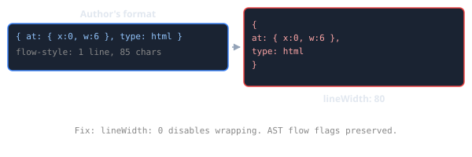

# The Seams Between Components

Five bugs, five different packages, one common cause: they all lived in the gaps between components that individually worked fine. The type system compiled. The tests passed. The operations did what they were supposed to. But the assumptions each component made about its neighbours were stale, incomplete, or never tested.

This is the residue of architectural migration. When #674 ripped out the old rows/columns grid model and unified on `items` with `grid` placement, the structural change landed cleanly. What didn't land cleanly was everything that referenced the old model by convention rather than by contract.

## The type that shouldn't exist

`TreeNodeType` is a union type: `'page' | 'grid-item' | 'component' | 'dataset' | ...`. After #674 removed the rows/columns model, it still included `'row' | 'column'`. TypeScript was happy — the type compiled, every reference to `'row'` and `'column'` was valid against the union, and `tsc --noEmit` passed clean. The stale values were invisible to the compiler because the compiler doesn't know that your domain no longer has rows.

The fix removed the values from the union, then chased every reference: `classifyPath` returning `'column'` for paths containing `columns`, `NODE_KEYS` including `'rows'` and `'columns'` for parent-path traversal, `tree-dnd.ts` listing `'column'` as a container drop target and `'row'` as an invalid one. Seven files, 169 lines removed.

The lesson: a type migration isn't done when the new type compiles. It's done when the old values are gone from the union. Until then, any code that handles the old values is dead code the compiler treats as live.

## The serialiser that wrapped your format

`PageDocument.toString()` calls the `yaml` library's `Document.toString()` with no options. The `yaml` library defaults `lineWidth` to 80. Flow-style YAML entries like:

```yaml
- { placement: { x: 0, y: 0, w: 6, h: 2 }, type: html, properties: { content: hello } }
```

That's 85 characters. On serialisation, the library wraps it:

```yaml
- {
    placement: { x: 0, y: 0, w: 6, h: 2 },
    type: html,
    properties: { content: hello }
  }
```

The document is semantically identical. Structurally, it's noise — every undo snapshot, every change notification, every file write expands the compact format into something the author didn't write. The `yaml` library preserves flow flags on the AST nodes perfectly. It just wraps them in the string output.



The fix: `this._doc.toString({ lineWidth: 0 })`. One argument. Format-stable roundtrips regardless of line length.

## The selection model nobody updated

`onExternalSelect` is the handler for `pages-grid-select` — the event that fires when the tree panel selects a grid item. It called `_setSelectedEl` (which creates the drag handle bar) and `_toggleDragHandles` (which shows it). It did not call `selectItem()` to update the controller's multi-selection model.

```typescript
this.onExternalSelect = (e: Event) => {
  const { itemId } = (e as CustomEvent).detail as { itemId: string };
  // DOM state updated: bar created, hover tracked
  this._setSelectedEl(itemId);
  this.hoveredId = itemId;
  this._toggleDragHandles(itemId);
  // selection model: not updated
};
```

If you tree-select item A, then shift-click item B in the grid for multi-select, the selection model doesn't know about A. It thinks B is the first selection. The DOM looks right — A has a handle bar, B gets one too — but the model that drives multi-select operations (delete selected, move selected) is wrong.

The fix adds `selectItem()` and `applySelectionOutlines()`, matching what `handlePointerDown` already does. Two lines. The kind of bug that only surfaces when you combine two selection mechanisms that were built in different sessions.

## The overlay that ghosted

After a cross-grid drag completes, the controller hides the selection overlay, dispatches the edit event, then — via a 50ms `setTimeout` — shows it again. The intent was to re-show the overlay at the item's new position. But the shell handles this: it re-renders the preview, runs `afterRender`, and calls `_applyPreviewHighlight` to position the overlay correctly.

The 50ms timeout fires before the re-render completes. The overlay appears at the old position for one frame, then jumps to the new position when the shell takes over. A ghost frame.

The fix removes the `setTimeout`. The shell already owns the overlay lifecycle after re-render.

## The animations that couldn't sync

The drag handle bar appears with a 150ms `setTimeout` delay, started on `pointerdown`. The selection outline transitions with 150ms CSS `transition: all 0.15s ease`, started on `click`. Since `pointerdown` fires before `click` (by however long the user holds the mouse button), the bar's timer starts 50-100ms earlier. They both run for 150ms but from different starting points.

The fix: committed selections — `pointerdown` (the user clicked) and `onExternalSelect` (the tree selected) — show the bar immediately. No setTimeout delay. The delay stays only for the hover-based fallback path, where the user might move the pointer away before the bar should appear.

## What connects them

None of these bugs would surface from testing a single component in isolation. The type error only matters when you try to pass `'row'` to a function that shouldn't accept it — but the type still allows it. The YAML wrapping only matters when a human reads the serialised output and sees their format destroyed. The selection model only matters when two selection mechanisms interact. The overlay ghost only matters when the controller and shell both try to manage the same DOM. The timing only matters when two animation systems run from different events.

These are seam bugs. They live in the contracts between components — the implicit assumptions about shared state, timing, and format that neither side documents or tests. A type system catches mismatched shapes. A test suite catches wrong outputs. Neither catches "these two things should happen at the same frame" or "this string output should look like what the user typed."

The fix pattern is the same in every case: find the actual contract (the type union, the toString options, the selection model, the overlay lifecycle, the event timing), make it explicit, and remove the stale assumption.
