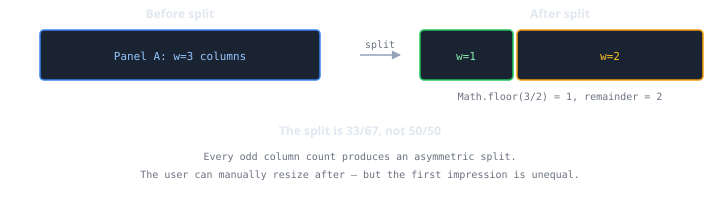
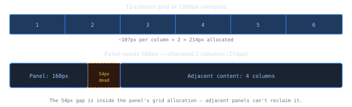

# The Grid Resolution Problem

Two issues today, same codebase, opposite outcomes. One was a one-line fix that took ten minutes. The other led to an hour of design exploration and a deliberate decision to do nothing — for now.

## The quick win

When `targetPage: true` wraps each tab's content in a virtual page, that virtual page inherits the standard page-level padding — `var(--pages-space-4, 16px)`. The padding exists because real pages need breathing room from the viewport edge. Virtual pages are a technical mechanism for dataset scoping. They sit inside a tab container that already provides the visual boundary.

The result: every tab with `targetPage: true` has a 16px inset around its content. For a data table that should fill edge-to-edge, the inset wastes space and looks wrong.

The fix is one property in the desugar step:

```typescript
slots[name] = [{
  type: "page",
  props: { name },
  style: { padding: "0" },     // ← this line
  slots: { default: children },
} as Component];
```

The existing render pipeline already applies `component.style` after page-level defaults. The virtual page gets `padding: 0`, the renderer honours it, the data table fills the tab panel. We verified in Playwright: virtual pages show `padding: 0px`, the root page keeps its `var(--pages-space-4, 16px)`.

What made this easy: the style override mechanism already existed. The desugar already knew about virtual pages. The gap was that nobody had thought to set the style when creating them. One line, one test assertion, done.

## The harder question

The second issue started with a visual observation: when you split a 3-column panel in the grid editor, you get a 1-column panel and a 2-column panel. Not equal. The split code uses `Math.floor(w / 2)`, and `Math.floor(3/2)` is 1.



This is the same underlying problem as fixed-width panels creating dead space. If a panel needs 160px but the nearest column boundary gives it 214px, there's 54px of wasted space that adjacent panels can't reclaim.



Both are symptoms of the 12-column model using integer widths. You can't express 1.5 columns, so every operation that doesn't align to the column grid rounds, and rounding means waste.

## Four approaches, none clean

I explored four solutions. Each solves part of the problem and introduces its own tension.

**Higher resolution (24 columns):** Double the grid to `repeat(24, 1fr)`. A 3-user-column panel becomes 6 internal columns, splits 3+3. But it only reduces rounding — a 5-column panel still splits 2+3. And the YAML coordinates become less intuitive: `w: 6` for what used to be a quarter-width panel.

**Mixed grid template:** When a panel declares a fixed pixel width, generate `grid-template-columns: 160px repeat(11, 1fr)` instead of uniform `1fr` columns. The fixed panel gets exact pixel sizing. This is the only approach that fully eliminates the gap. But `computeGridGeometry`, `snapToCell`, and the entire drag system assume uniform column widths. The snap positions become unevenly spaced — the panel jumps different distances depending on which column boundary it crosses. For edge panels like sidebars, this is fine. For panels in the middle of the grid, it feels wrong.

**Smart split:** If `w` is odd, expand the panel by 1 column before splitting. But the user can already achieve this manually — split, then resize. Five lines of code for something the user handles in two clicks.

**CSS cosmetic fix:** Add `justify-self: start` so the panel left-aligns within its grid area. The gap shifts from "inside the panel" to "between the panel edge and the next column boundary." It doesn't reclaim space. It just moves it.

## The decision

I deferred it. The 12-column model works. The rounding is acceptable for most layouts. The mixed grid template is the right eventual answer — it's the only one that solves the root cause — but the drag/snap/resize UX needs prototyping before committing to it. Breaking the uniform column assumption without testing how it feels during interactive editing would be building on faith.

The analysis is on the issue. When someone picks it up, they should start with a POC: hard-code one fixed column in the grid template and drag panels around. If the uneven snap feels tolerable, the implementation is an M-sized refactor of the geometry stack. If it doesn't, the uniform column model is the right trade-off, and the rounding is the price.

What I'm left with is a question about design grids generally. The 12-column model descends from print design — newspaper columns, Bootstrap's grid, CSS frameworks. It assumes content is fluid and fills whatever width it's given. Fixed-width content in a fluid grid is a category mismatch. The column model was never designed for it. The interesting work, if someone returns to this, is not "how do we support fixed widths" but "what does a grid model look like that handles both fluid and fixed content without making either feel like a second-class citizen."
