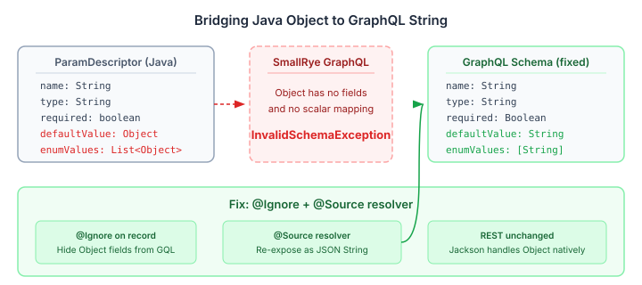

# When Object Meets GraphQL

Java lets you put anything in an `Object`. GraphQL makes you say exactly what you mean. When these two meet at a schema boundary, one of them has to give.

## The failure

The playbook library exposes script descriptors through both REST and GraphQL APIs. Each script has parameters, and each parameter has a default value and an optional set of enum values. In Java, the model is straightforward:

```java
public record ParamDescriptor(String name, String type, boolean required,
                               Object defaultValue, List<Object> enumValues) { }
```

`Object` works fine here. A default value might be `"blank"` (String), `42` (Integer), `true` (Boolean), or even a nested map. Jackson serialises all of these naturally for the REST API — a string becomes a JSON string, a number becomes a JSON number. No configuration needed.

SmallRye GraphQL, which generates the schema automatically from annotated Java types, has a different opinion. When it encounters `Object`, it tries to build a GraphQL output type from it. `Object` has no fields. It's not a known scalar. The schema generator fails at boot:

```
InvalidSchemaException: Object must define one or more fields
```

The entire application won't start. The Helpdesk demo currently works around this by disabling the GraphQL endpoint entirely and using only REST and MCP.

## Why this happens

GraphQL is a typed query language. Every field in a GraphQL schema must resolve to either a scalar (`String`, `Int`, `Boolean`, `Float`, `ID`), an enum, or an object type with its own declared fields. There is no `any` type. There is no union of scalars.

Java's `Object` is the opposite — it's the universal supertype, the ultimate "I'll figure it out at runtime." REST APIs can get away with this because JSON is structurally typed: `{"defaultValue": 42}` is valid JSON regardless of what the Java type says. GraphQL requires the type to be declared before any data flows through it.

The mismatch is fundamental: **REST serialises values; GraphQL serialises types.**

## The fix: @Ignore + @Source

The solution uses two MicroProfile GraphQL annotations to bridge the gap without changing the record or the REST API.



**Step 1: Hide the Object fields from schema generation.**

```java
public record ParamDescriptor(String name, String type, boolean required,
                               @Ignore Object defaultValue,
                               @Ignore List<Object> enumValues) { }
```

`@Ignore` tells SmallRye to skip these fields when generating the GraphQL type. The record still works identically for REST — Jackson doesn't care about `@Ignore`. The annotation propagates from the record component to the accessor method via Java's annotation propagation rules (since `@Ignore` targets `ElementType.METHOD`).

**Step 2: Re-expose the values as JSON strings via a Source resolver.**

```java
@GraphQLApi
public class ParamDescriptorResolver {

    private static final ObjectMapper JSON = new ObjectMapper();

    @Name("defaultValue")
    public String defaultValue(@Source ParamDescriptor param) {
        if (param.defaultValue() == null) return null;
        return JSON.writeValueAsString(param.defaultValue());
    }

    @Name("enumValues")
    public List<String> enumValues(@Source ParamDescriptor param) {
        return param.enumValues().stream()
                .map(v -> JSON.writeValueAsString(v))
                .toList();
    }
}
```

The `@Source` annotation is SmallRye's extension mechanism — it adds fields to an existing GraphQL type without modifying the type itself. The resolver sits in the runtime module (which has the GraphQL dependency), keeping the model module clean. The `@Name` annotation ensures the GraphQL field names match the original record component names.

The resulting GraphQL schema has `defaultValue: String` and `enumValues: [String]`. A default value of `42` becomes the JSON string `"42"`. A default of `"blank"` becomes `"\"blank\""`. Clients parse the JSON string to recover the typed value.

## When to reach for this pattern

The `@Ignore` + `@Source` pattern applies whenever:

1. **A model type is shared between REST and GraphQL.** Changing the Java type to suit GraphQL would break REST serialisation. The pattern lets each API present the same data in its native idiom.

2. **A field uses a type that GraphQL can't represent.** `Object`, `Map<String, Object>`, `JsonNode`, any polymorphic type. The resolver serialises to a GraphQL-friendly form (usually `String` with JSON encoding).

3. **The model module shouldn't depend on GraphQL.** Making `microprofile-graphql-api` an `<optional>` dependency keeps the annotation available at compile time without forcing it on downstream consumers. The annotation is inert unless SmallRye is on the runtime classpath.

The key insight is that `@Source` resolvers live in the runtime module, not the model module. The model stays clean. The GraphQL wiring is an adapter layer, not a model concern.

## Annotation propagation on records

One subtlety: Java records have specific rules for how annotations on record components propagate to the generated constructor parameters, fields, and accessor methods. An annotation propagates to the accessor method only if its `@Target` includes `ElementType.METHOD` (or `ElementType.RECORD_COMPONENT`). MicroProfile's `@Ignore` targets `FIELD`, `METHOD`, and `PARAMETER`, so it propagates to all three.

If you're using a different annotation that only targets `FIELD`, it won't propagate to the accessor — and SmallRye introspects accessor methods, not fields. The schema test we added verifies the propagation works:

```java
Set<String> ignoredComponents = Arrays.stream(ParamDescriptor.class.getRecordComponents())
        .filter(rc -> rc.getAccessor().isAnnotationPresent(Ignore.class))
        .map(RecordComponent::getName)
        .collect(Collectors.toSet());

assertThat(ignoredComponents)
        .containsExactlyInAnyOrder("defaultValue", "enumValues");
```

This test is the regression guard. If someone changes the annotation or the record structure, the test fails before the schema generator does.

## Housekeeping

Three smaller fixes in the same session:

**classifyPath simplification (#711).** Two consecutive guards in the builder's YAML path classifier both returned `'page'` with conditions already guaranteed by earlier guards. Merged into an unconditional `return 'page'`.

**Missing jsdom annotations (#712).** Four test files in `pages-builder` required DOM APIs but ran in Node's default environment, producing 160 `ReferenceError: document is not defined` failures. Added `// @vitest-environment jsdom` to each. The workspace symlink means fixing four files fixes all eight test-runner entries.

**lineWidth monitoring (#713).** A previous fix set `lineWidth: 0` globally to prevent the YAML library from wrapping flow-style maps. The concern was that it might also affect long plain scalars or block scalars. Added regression tests for all three scalar types — long strings stay on one line, block scalars keep their pipe indicator, flow maps remain inline. No corruption found.
