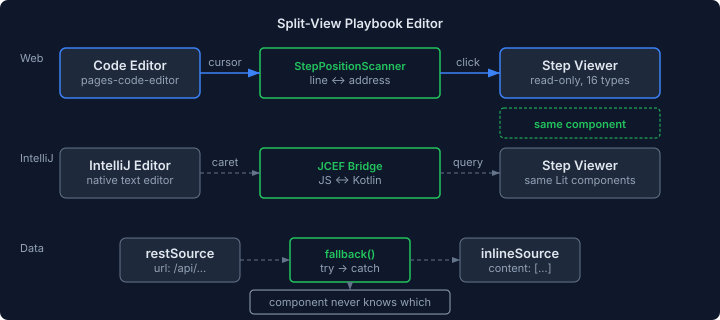

# One YAML, Two Worlds

The JSON Apps runtime shipped with a problem I should have seen earlier. Every app — helpdesk, contacts, tasks — needed two copies of its page YAML. One with `url:` for the server backend. Another with `content:` for the gallery. Same schema, same columns, same components. Two files that drift apart the moment someone edits one.

The fix started as a small thing: let a dataset carry both `url` and `content`. Try the URL; if the server isn't there, fall back to the inline data. But it exposed something more interesting about the data pipeline we'd already built.

## The Abstraction Was Already There

Pages has a `DataSource` interface that every data provider implements — REST, WebSocket, SSE, inline, server-query. Components never see which one they're talking to. The simulation system works the same way: wrap any `DataSource` with `simulated()`, apply mutations over time, and the component downstream has no idea the data is synthetic.

The dual-mode pattern is the same mechanism applied to a different problem. A new `fallback()` combinator tries the primary source; on error, it connects the secondary. The component never knows which path delivered the data.

```typescript
export function fallback(primary: DataSource, secondary: DataSource): DataSource {
  // tries primary.connect() → on error → secondary.connect()
  // component receives one snapshot, never knows which source
}
```

The pipeline change was three lines in the routing logic. When a dataset definition has both `url` and `content`, wrap `restSource(url)` with `inlineSource(content)` via `fallback()`. The validator relaxed from "exactly one of url/content/join" to "join can't combine with others; url+content is fine."

One YAML file. Backend running → REST data with full CRUD. No backend → inline seed data. Gallery samples, server deployment, and the "Apps Within Apps" demo all consume the same file.

## The Playbook Editor Needs the Same Thinking

The second half of the day was foundation work for a split-view playbook editor — YAML on the left, step visualization on the right, click-sync between them.

The interesting piece is `StepPositionScanner`. It walks raw YAML and maps each step to a line range and a hierarchical address: `"0"` for a top-level step, `"1.then.0"` for the first step inside an if-else's then branch, `"2.catch.1"` for the second step in a try-catch handler. The scanner doesn't parse YAML into an AST — it tracks indentation and recognises control-flow keywords, producing a flat list of `{line, endLine, address}` entries.

This mapping is what makes click-sync work in both directions. Click a step card → look up its address → find the YAML line range → move the editor cursor. Move the cursor in the editor → find the deepest step containing that line → highlight the matching card. The same position map drives both.



The step viewer already renders 16 component types — step cards, swim lanes, if-else branches, try-catch blocks, match arms, race views. We added `data-step-address` attributes and click events to every rendered card, plus a `setActiveStep(address)` method for the reverse direction. The `<playbook-split-view>` container wires it all together: debounced YAML re-parse on edit, bidirectional sync via the position scanner.

## Why This Matters for IntelliJ

The split-view is designed to be consumed by the IntelliJ plugin via JCEF. IntelliJ provides its own text editor; the plugin embeds the step viewer in a browser panel alongside it. The sync protocol is minimal: IntelliJ sends cursor line numbers to the JCEF panel via `executeJavaScript`; the panel sends step click events back via `JBCefJSQuery`. The position scanner runs in both environments — it's just TypeScript.

This is the same data abstraction principle again. The step viewer doesn't know whether it's running in a browser tab or in an IntelliJ panel. The position scanner doesn't know whether the editor is Monaco or IntelliJ's native editor. The sync protocol is the seam — both sides speak line numbers and step addresses. Everything else is implementation detail.

I'll build the IntelliJ `FileEditorProvider` next session. The web components are done; the remaining work is Kotlin wiring and a standalone JS bundle for JCEF consumption.
