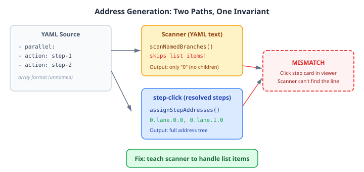

# The Address That Didn't Exist

Two components, two packages, one invariant they were supposed to share: a hierarchical address scheme for steps inside a playbook. Click a step card in the viewer, it emits an address. The scanner looks up that address to find the YAML line. Except for three of its four control flow types, the scanner had no idea what the viewer was talking about.

## Two representations of the same thing

A playbook `parallel:` block has two YAML forms. Named branches use an object — each key is a lane name:

```yaml
- parallel:
    agent:
      - action: do-work
    reviewer:
      - action: review-work
```

Unnamed branches use an array — each element is a single step running in its own lane:

```yaml
- parallel:
    - action: step-1
    - action: step-2
```

The walker in `yaml-core` resolves both into a `ParallelStep`. Named branches produce `NamedBranch[]` with names from the YAML keys. Array branches produce a flat `steps[]` with no branch names. The resolved type faithfully represents both forms.

## The addressing split

`assignStepAddresses` in the step viewer operates on resolved steps. It handles both paths:

```
Named:   0.lane.agent.0    (branch.name)
Unnamed: 0.lane.0.0        (numeric index, .0 for the single step)
```

`StepPositionScanner` in yaml-core operates on raw YAML text. It calls `scanNamedBranches`, which scans for key-colon patterns at the expected indent. Named branches work — `agent:` and `reviewer:` are keys, they get scanned, addresses match. But unnamed branches are list items (`- action: ...`), and `scanNamedBranches` has this line:

```typescript
if (stripped.startsWith('- ')) { i++; continue; }
```

Skip. Next line. The scanner produces the address `0` for the parallel step itself, and nothing for its children. The viewer emits `0.lane.0.0` on click. The scanner has no entry for that address. The cursor doesn't move.



## Why it stayed hidden

The split-view playbook editor (#720) landed with named-branch test playbooks — the demo YAML uses `agent:` and `reviewer:` lanes. Click sync worked. The unnamed array form never appeared in the demo, so the mismatch never fired.

This is the pattern that makes addressing bugs insidious. Each component is correct in isolation. The scanner scans all the YAML structures it was designed for. The step-click assigns addresses to all the resolved types it receives. The contract between them — "these two functions produce identical strings for the same step" — exists only as an assumption.

## Three fixes, three address conventions

The skip-list-items line in `scanNamedBranches` affects parallel, race, and select — every control flow type whose YAML uses array format. Each has a different address convention.

**Parallel unnamed lanes** (`0.lane.0.0`) — each list item is a lane containing a single step. The `.0` suffix comes from `scanBlock` treating the lane as a block of one. Fix: iterate list items, call `scanBlock` per lane.

**Race** (`0.race.0`, `0.race.1`) — flat sequential indices. Each list item is a direct child step. Fix: delegate to `scanBlock` for the entire children region. `scanBlock` already numbers list items sequentially and recurses into control flow:

```typescript
if (label === 'race') {
  scanBlock(lines, i, stepEnd, nameIndent,
    `${address}.race`, results);
  return;
}
```

The `return` is deliberate — `scanBlock` processes all children in one pass, so there's no reason to continue the per-line loop.

**Select** (`0.select.events.0`) — named branches, but the names come from channel values, not YAML keys. Each list item starts with `subscribe: channelName` or `wait: signalName`. The channel name goes in the address:

```typescript
if (label === 'select') {
  const childEnd = findNextSibling(lines, i, nameIndent, stepEnd);
  const name = selectBranchName(line);
  if (name) {
    const stepAddr = `${address}.select.${name}.0`;
    results.push({ line: i, endLine: childEnd, address: stepAddr });
    // scan for nested control flow in the branch body
  }
  i = childEnd;
  continue;
}
```

Select needed a helper to extract the name — `selectBranchName` strips the list item prefix, identifies `subscribe:` or `wait:` as the key, and returns the value. It also strips surrounding YAML quotes, since the runtime parser does the same.

## What the review caught

The first select implementation registered the branch step and moved on. The code review flagged the missing recursion: if a select branch contains an `if:` or `try:`, the inner addresses (`0.select.events.0.then.0`) would never appear. The fix scans sibling keys of the branch for control flow keywords and recurses when found.

The review also identified a gap I chose not to fix: the object form of `subscribe:` where the channel name is a child key (`subscribe:\n  channel: events`). The walker supports both string and object forms. The scanner currently handles only the inline string form. No existing YAML in the repo uses the object form, so it's tracked as a known limitation rather than a blocker.

## The broader pattern

`scanNamedBranches` was written for the named-key case — object-format YAML where branches are dictionary keys. Three of its four callers pass array-format YAML. The function was correct for its original design. The callers evolved past it.

This is worth watching in any system where two components independently produce identifiers for the same entity. The contract is invisible — no shared type, no shared function, no compile-time check. The only way to catch a mismatch is a test that runs both paths on the same input and compares. For the named case, the existing tests happened to cover it. For the unnamed case, they didn't.

The fix across all three is about 25 lines of scanner code and 10 test cases. The lesson is that addressing invariants across abstraction boundaries don't announce themselves when they break.
