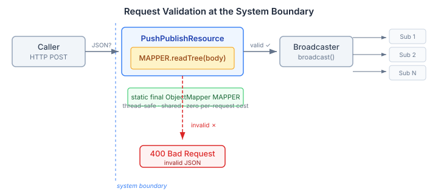

# Three Things Code Review Found in push-runtime

Code review of the new `PushPublishResource` (#721) turned up three issues worth fixing before they bit someone. None was a bug in the feature — all were gaps that the new code either inherited or exposed.

## Trusting the Wire

`PushPublishResource.publish()` accepts a raw `String` body and passes it straight to `EventBroadcaster.broadcast()`. The `@Consumes(MediaType.APPLICATION_JSON)` annotation tells JAX-RS to expect JSON, but it doesn't validate it — it just sets the content type expectation. If a caller sends `not valid json {{{` with a JSON content type header, the endpoint accepts it, stores it in the event store, and broadcasts it to every subscriber. Every downstream consumer then has to deal with malformed data.

The fix is a guard clause: parse the body with `ObjectMapper.readTree()` before the broadcast call. If it fails, return 400 with a clear message. Five lines of code. The interesting part isn't the fix — it's the question of where validation belongs.

```java
try {
    MAPPER.readTree(body);
} catch (JsonProcessingException e) {
    throw new BadRequestException("request body must be valid JSON");
}
```

The endpoint's current callers are YAML workers via `call: http`, and they construct valid JSON. So why bother? Because the system boundary is the place to enforce invariants, not the caller. A future caller — a webhook integration, a debug tool, a misconfigured worker — will send garbage eventually. Catching it at the door means every component downstream can trust that what it receives is well-formed. Defense in depth at system boundaries is cheap insurance.



## The Shared Counter Problem

The second finding was subtler. `push-runtime` has two `@QuarkusTest` classes that exercise the event broadcaster: `BroadcastIntegrationTest` (direct CDI injection) and `PushPublishResourceTest` (HTTP endpoint). Both share a single Quarkus application instance within a test run, which means they share a single `@ApplicationScoped` `InMemoryEventStore`.

The event store assigns monotonically increasing sequence numbers per topic. When both test classes broadcast to the same topic (`nobody:listens`), the second class to run gets a sequence number that depends on what the first class already did. Any test asserting `seq == 1` is order-dependent.

The earlier session's blog entry noted this and fixed the specific collision — switching the overlapping assertion from `equalTo(1)` to `greaterThan(0)`. But it also said that `equalTo(1)` was "safe" for topics unique to a single test class. That's true today and wrong tomorrow. The moment someone adds a new test class that broadcasts to `orders:new`, the previously-safe assertion breaks — and the failure will be intermittent, because test class ordering isn't deterministic across JVM restarts.

I went through every seq assertion in both test classes and replaced them all:

| Before | After | Why |
|--------|-------|-----|
| `equalTo(1)` | `greaterThan(0)` | Seq is positive, not necessarily 1 |
| `isEqualTo(1)` | `isGreaterThan(0)` | Same pattern, AssertJ variant |
| `contains("\"seq\":1")` | `contains("\"seq\":")` | Verify seq is present, not its value |
| `isEqualTo(1)` / `isEqualTo(2)` for replay ordering | `get(1).seq() > get(0).seq()` | Monotonic ordering, not absolute values |
| `hasSize(1)` for cross-test topic | `isNotEmpty()` | Event stored, count unreliable |

The pattern generalises: any `@ApplicationScoped` bean that accumulates state — counters, caches, registries — will carry that state across `@QuarkusTest` classes in the same test run. The safe path is asserting properties (positive, non-empty, monotonic) rather than specific values. The unsafe path is writing `equalTo(1)` and hoping no future test class shares the topic.

And then it showed up again, immediately. `TopicRegistry` — the trie that tracks which connections are listening to which topics — is also `@ApplicationScoped`. Listeners registered by one test class survive into the next. The tests happen to use unique topic names, so nothing fails today. But the fix for `InMemoryEventStore` was about eliminating that "today" qualifier. I added `TopicRegistry.clear()` and wired it into both test classes' `@BeforeEach`, right next to `testConfig.clear()`. Same pattern, same rationale: clean slate per test class, no shared state to reason about.

## The Object You Don't Need to Build Twice

The guard clause originally created a new `ObjectMapper` on every request:

```java
new ObjectMapper().readTree(body);
```

ObjectMapper is not a lightweight object. Construction triggers reflection over the classpath, discovers Jackson modules, and builds internal type caches. At low request rates the cost is invisible. At scale it's a per-request allocation that the garbage collector has to clean up — and the type cache it builds gets thrown away immediately, defeating the point of having one.

The fix is a static final field:

```java
private static final ObjectMapper MAPPER = new ObjectMapper();
```

Jackson's documentation is explicit: mapper instances are fully thread-safe provided that all configuration occurs before any read or write calls. A vanilla instance with no custom configuration — which is all that `readTree()` for validation needs — is safe to share from a static field across any number of concurrent requests.

The alternative was CDI injection. `PushProducers` already creates an ObjectMapper internally — but for a different purpose. It wraps one inside a `JsonWriter` lambda for event serialization. That mapper lives inside the lambda; the validation mapper just needs to parse. Injecting from CDI would have meant either reusing an instance configured for a different job, or adding a new producer for a one-line use case. A static field is simpler, has no container dependency, and makes the intent clear: this is a parser, not a configured serializer.

The broader principle: if you're writing `new ObjectMapper()` inside a method body in a Java service, you almost certainly want it somewhere else. Static final for stateless validation. CDI-injected singleton when you need custom serialization settings. Per-request construction only when you're genuinely configuring the mapper differently per call — and in a decade of Java services, I've never seen a legitimate case for that
