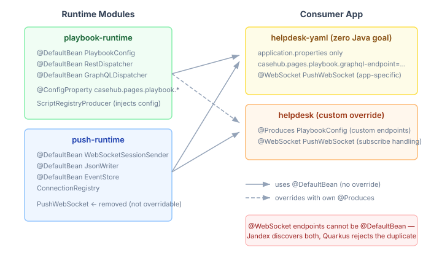

# The Producer That Was Always There

Every Pages app carries the same CDI wiring boilerplate — three producer methods for the playbook runtime, four beans for push infrastructure. Same code, copy-pasted into `helpdesk`, `helpdesk-yaml`, and every future app. The kind of duplication that is easy to live with until you count the copies.

The fix is `@DefaultBean` — Quarkus's mechanism for "provide this if the consumer hasn't". The runtime module ships the sensible default. Apps that need custom configuration override with their own `@Produces` method. Apps that don't need anything custom write zero Java.



## Playbook: config from properties, not code

`PlaybookConfig` is the interesting piece. It has six fields — GraphQL endpoint, push endpoint, REST base URL, per-domain endpoint overrides, and a library path. We wired all of them through `@ConfigProperty` with the `casehub.pages.playbook.*` namespace and localhost defaults:

```java
@Produces @ApplicationScoped @DefaultBean
PlaybookConfig playbookConfig(
        @ConfigProperty(name = "casehub.pages.playbook.graphql-endpoint",
                        defaultValue = "http://localhost:8080/graphql")
        String graphQLEndpoint,
        // ...
```

The REST base URL derives from the GraphQL endpoint by stripping `/graphql` when not explicitly set — the same logic that was duplicated in every app's producer. `RestDispatcher` and `GraphQLDispatcher` need no configuration at all; their no-arg constructors do the right thing.

`ScriptRegistryProducer` already injected `PlaybookConfig` via CDI. With the new default producer, that injection resolves without the app providing anything. The whole chain — config to registry to orchestrator — works out of the box.

## Push: the endpoint trap

The push side had a trap. I included a default `@WebSocket(path = "/ws/push")` endpoint alongside `ConnectionRegistry` and `WebSocketSessionSender`. It looked right — eliminate the endpoint boilerplate too.

But WebSocket endpoints aren't CDI beans. They're discovered via Jandex indexing at build time. Two `@WebSocket` classes at the same path means a build failure — and there's no `@DefaultBean` escape hatch for endpoints. Any app that defines its own push endpoint would clash with the runtime's default.

The review caught it. `ConnectionRegistry` (the `ConcurrentHashMap<String, WebSocketConnection>` wrapper) and `WebSocketSessionSender` (the `SessionSender` bridge) stay — they're the useful infrastructure that every app duplicates identically. The endpoint itself stays app-level, because apps handle different push request types. `Subscribe` and `Unsubscribe` delegate to app-specific registries like `DatasetRegistry`; they're not core protocol the way `Listen`/`Unlisten` are.

## What this opens up

This work is part of the zero-Java goal for Pages apps — the point where a `.page.yaml` file is the only artifact a consumer provides, with no Java glue code at all. Each producer that moves into the runtime module is one fewer class in the app's source tree, one fewer thing to copy when creating a new app.

The gap worth filing: a conditional WebSocket endpoint mechanism. Something that lets runtime modules provide a default endpoint that apps can override without classpath conflicts. Without it, the endpoint remains the one piece of push wiring that every app must write by hand.
