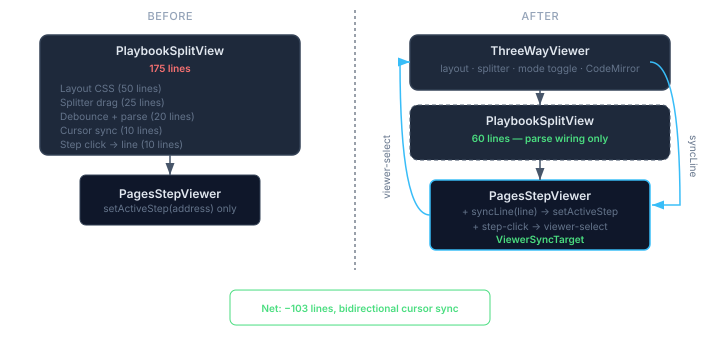

# The Controller Pattern Pays Off

When we built `pages-three-way-viewer` for #217, `ViewerController` felt like overkill for three modes and a split ratio. A class with a constructor, getters, `setMode`, and an `onChange` callback — maybe 48 lines. The kind of thing you write because the pattern is clean, not because you need it yet.

Two weeks later, it justified itself twice in one session.

## The split-view collapse

`PlaybookSplitView` was 175 lines of Lit component doing five things: layout CSS, a draggable splitter, debounced YAML parsing, cursor-to-step sync, and step-click-to-cursor sync. All of that except the parsing is what `ThreeWayViewer` already does — with a CodeMirror editor instead of a raw textarea, and the `ViewerSyncTarget` protocol for bidirectional sync.

The migration required one design choice: where does the line-to-step-address translation live? `ThreeWayViewer` sends `syncLine(lineNumber)` to whatever element sits in its `visual-pane` slot. `PagesStepViewer` speaks in step addresses (`setActiveStep(address)`). The translation needs `StepPositionScanner` and `positionInfos` from parsing.

I put it in `PagesStepViewer` itself. The viewer already imports from `yaml-core` for `ResolvedStep`. Adding `positionInfos` as a property and a `syncLine` method that maps line → address is cohesive — the step viewer knows about step positions because it renders steps. The alternative was a wrapper element that exists solely to hold a three-line translation function. Over-engineering for purity's sake.

The result: `PlaybookSplitView` drops to 60 lines. It renders `<pages-three-way-viewer>` with `<pages-step-viewer slot="visual-pane">`, listens for `value-change`, runs `parseAndResolve`, and updates three properties. The splitter, layout, debounce, and sync protocol all disappear — `ThreeWayViewer` handles them.

## The second consumer

The playbook controller's floating YAML viewer had a familiar smell: two booleans (`_yamlOpen` and `_docked`) encoding three effective states (closed, docked, floating), managed by eight methods that all manipulate the same two flags. A state machine implemented by accident.

The question was whether to use `ViewerController` directly. I looked at it carefully — `ViewerController` manages `yaml`/`visual`/`split` mode plus `splitRatio`. The playbook controller needs `closed`/`docked`/`floating` with no split ratio. Mapping `yaml` → `closed` works mechanically but means code reading `controller.mode === 'yaml'` to check if a floating panel is hidden. That's a readability tax on every future reader.

So I created `PanelController` as a sibling — same architecture (constructor with options, state getter, `setMode`, `onChange` callback), different state shape. 30 lines. `toggle()` for the common case of closed ↔ docked. The playbook controller's methods collapse: `_toggleYaml()` becomes `this._panel.toggle()`, `_undockViewer()` becomes `this._panel.setMode('floating')`, and the onChange callback handles the DOM side effects (create viewer, show/hide, snap position).

Two isn't enough to justify a generic `StateController<M>` base class. If a third consumer appears, the extraction is straightforward. For now, two focused classes with explicit type names read better than a generic with type parameters.

## The pattern that earns its weight

Both changes follow the same principle: separate the state machine from the DOM effects it triggers. `ViewerController` and `PanelController` are pure logic — no DOM, no Lit, no browser APIs. They manage transitions and notify. The Lit component reacts to notifications and does DOM work. This split makes the state testable in isolation and the component code shorter — it handles rendering, not bookkeeping.

The architectural bet from #217 was that this pattern would compose. It did.
